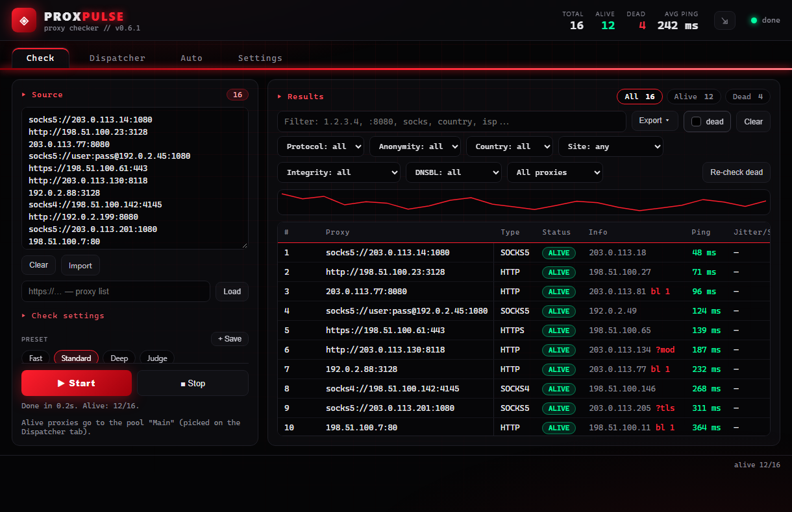
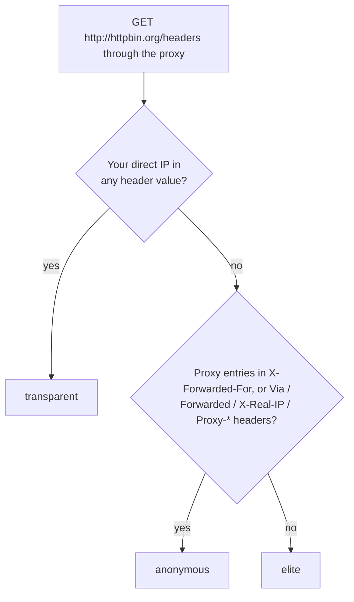

# ProxPulse

**English** | [Русский](README.ru.md)

[](https://github.com/nechel12/proxpulse/actions/workflows/ci.yml)
[](https://github.com/nechel12/proxpulse/releases)
[](https://github.com/nechel12/proxpulse/releases)
[](LICENSE)
[](#install)
[](src-tauri/Cargo.toml)
[](https://tauri.app/)
[](SECURITY.md)
[](https://github.com/nechel12/proxpulse/commits/main)
[](CONTRIBUTING.md)

Desktop proxy checker for Windows, Linux and macOS. It checks HTTP, HTTPS,
SOCKS4 and SOCKS5 proxies for liveness, latency, geolocation, anonymity,
content and TLS integrity and IP blocklists, keeps the alive ones in named
pools, runs a local rotating HTTP/SOCKS5 dispatcher per pool, hands proxies to
scripts over a local API, re-checks the pools on a schedule and posts them to
webhooks.

Stack: **Tauri 2 + Rust (tokio, reqwest, rustls) + Vite + TypeScript**. All
network work, parsing and scheduling run in the Rust backend; the UI is a thin
TypeScript layer. Russian and English UI, picked from the system language on
first launch; dark and light themes.

> Status: pre-1.0. Settings, export formats and webhook payloads may change in
> minor releases; changes are listed in [CHANGELOG.md](CHANGELOG.md).



## Contents

- [Install](#install) · [Quick start](#quick-start)
- Checking: [Input formats](#input-formats) · [Check target](#check-target) ·
  [Check settings](#check-settings) · [Deep checks](#deep-checks) ·
  [How verdicts are decided](#how-verdicts-are-decided) · [Results table](#results-table) ·
  [Export](#export)
- [Dispatcher](#dispatcher) · [Named pools](#named-pools) · [Pool API](#pool-api) ·
  [Scheduled checks and webhooks](#scheduled-checks-and-webhooks) ·
  [Settings, tray and updates](#settings-tray-and-updates)
- [Privacy and local data](#privacy-and-local-data) ·
  [Troubleshooting](#troubleshooting) · [Limitations](#limitations) ·
  [Security](#security)
- [Build from source](#build-from-source) · [Project structure](#project-structure) ·
  [Contributing](#contributing)

## Install

Builds for every platform are attached to each
[GitHub release](https://github.com/nechel12/proxpulse/releases):

| Platform | File | Updates |
|---|---|---|
| Windows x64 | `…_x64-setup.exe` — NSIS installer (recommended) | built-in |
| | `…_x64_en-US.msi` — MSI installer | manual |
| | `…-portable.exe` — no installer (data still goes to `%APPDATA%\com.nechel12.proxpulse`) | replace the file |
| Linux x64 | `…_amd64.AppImage` | built-in |
| | `…_amd64.deb`, `…x86_64.rpm` | package manager |
| macOS | `…_aarch64.dmg` (Apple Silicon), `…_x64.dmg` (Intel) | built-in |

`SHA256SUMS.txt` lists the checksum of every file; `latest.json` and `.sig`
files serve the built-in updater. Release tags from 0.6.0 on are signed with
the SSH key in [`docs/proxpulse-release.pub`](docs/proxpulse-release.pub);
[RELEASING.md](RELEASING.md) shows how to check one.

> [!NOTE]
> **Windows:** builds are not Authenticode-signed, so SmartScreen may show
> "Windows protected your PC": **More info → Run anyway**. Before that, the
> file can be checked against `SHA256SUMS.txt` in PowerShell:
> `(Get-FileHash .\ProxPulse_X.Y.Z_x64-setup.exe).Hash` (compare
> case-insensitively).
>
> **macOS:** builds are signed ad hoc, not with an Apple certificate. On first
> launch macOS refuses to open the app; on macOS 15 and later the context
> menu's **Open** no longer helps: **System Settings → Privacy & Security →
> Open Anyway** (shown right after the refused launch). Or, after copying the
> app to Applications: `xattr -dr com.apple.quarantine /Applications/ProxPulse.app`.
> The author has no Mac: macOS builds are verified by compilation only and are
> not guaranteed to work. Problem reports should include the diagnostics from
> the Settings tab.
>
> **Linux:** an AppImage needs `chmod +x ProxPulse_*.AppImage` and FUSE 2
> (`libfuse2`, `libfuse2t64` on Ubuntu 24.04); without FUSE it runs with
> `--appimage-extract-and-run`.

## Quick start

1. Paste a proxy list in any format into **Source**, drop files on it, or
   import files or a URL. The counter shows how many proxies a check will test.
2. Pick a preset — **Standard** checks liveness plus every deep check,
   **Fast** liveness only — and press **Start** (Ctrl+Enter). Results stream
   in as proxies finish; **Stop** (Esc) aborts at once.
3. Export the alive proxies (**Export** → `.txt`, `.json`, `.csv` or **Copy**),
   or turn on the dispatcher and point a browser at `127.0.0.1:1080` as an
   HTTP or SOCKS5 proxy.
4. Optionally, the **Auto** tab re-checks the pool every N minutes and posts it
   to webhooks.

## Checking

### Input formats

The format is detected per line; scheme case does not matter:

- `127.0.0.1:8080`, `proxy.example.com:8080`, `[2001:db8::1]:8080`
- `user:pass@127.0.0.1:8080`
- `http://…`, `https://…` (TLS to the proxy), `socks5://…`, `socks5h://…`,
  `socks://…`, `socks4://…`, `socks4a://…`
- `127.0.0.1:8080:user:pass`, `user:pass:127.0.0.1:8080`,
  `127.0.0.1:8080@user:pass` and `127.0.0.1:8080 user pass`; a password keeps
  any characters, `/`, `#`, `;` or `!` included
- `127.0.0.1:8080:socks5` (protocol as a suffix)
- CSV, tabs or spaces: `127.0.0.1,8080,user,pass`, `socks5,127.0.0.1,8080`
- Tables copied from free-proxy sites: the IP and port columns are taken, the
  country, anonymity and other columns are ignored
- JSON: an object, an array or a log with `host`/`ip`, `port`, `username`,
  `password`, `type` fields (`"https"` there means an HTTP proxy that supports
  HTTPS sites)
- Numbered or bulleted lists (`1) …`, `- …`, `[x] …`), `# …` and `// …`
  comments, `ip:port` inside prose

Text files of any kind (TXT, CSV, JSON, LOG) and URLs (up to 2 MB, public
hosts only) are imported with the same parser. Every entry must normalize to a
proxy the checker can use, and one proxy written two ways counts once, so the
counter equals the number of proxies a check tests. A check and a pool take up
to 20,000 proxies, and the source field up to 10 MB of text; a longer list is
checked up to that number, and the status line says so.

> [!NOTE]
> IPv6 addresses need square brackets (`[2001:db8::1]:8080`); the bare form is
> ambiguous and is not accepted. `socks4` cannot carry IPv6 or host names:
> `socks5` or `socks4a` is used for them.

### Check target

The **public server** mode requests a ready-made endpoint or a custom URL
through every proxy: `google`/`cloudflare` `generate_204` (fastest),
`api.ipify.org` and `httpbin.org/ip` (show the exit IP), `http://ip-api.com/json`
(exit IP and geo in one request), `example.com`, or **Custom URL…**. The URL
that will actually be requested is shown under the list. A proxy counts as
alive only when a known address gives its own answer (`204` for
`generate_204`, the JSON of ip-api, httpbin or the judge, the address from
ipify, the example.com page), so a captive portal or a server that answers 200
to everything is dead; a custom URL is taken on any 2xx. A judge's own "busy"
answer (429, 503) still shows the proxy works, without a verdict.

The **ProxPulse Judge** mode uses a [ProxPulse Judge](https://github.com/nechel12/proxpulse-judge)
instance: the built-in public one (`proxycheck.lmtunnel.com`) or your own
server, entered as a host (`judge.example.com`, optionally with a port or a
path). **Fast** checks liveness only (`/generate_204`); **Full** asks `/judge`
for geo, IP type, anonymity and a content hash and replaces the deep checks.
The **HTTPS** and **HTTP** boxes decide how the judge is reached:

| Choice | Through each proxy | Result |
|---|---|---|
| HTTPS + HTTP (default) | `https://…/judge`, then `http://…/judge` | liveness, ping and geo over HTTPS; anonymity and integrity over HTTP |
| HTTPS | `https://…/judge` | liveness, ping and geo; no anonymity or integrity |
| HTTP | `http://…/judge` | everything over HTTP; proxies limited to port 443 look dead |

> [!IMPORTANT]
> **Anonymity needs plain HTTP.** Inside an HTTPS tunnel the proxy can neither
> add headers nor alter the answer, so every proxy would look `elite`. Over
> HTTP the proxy sees the request, and could also rewrite the answer. The
> judge signs each `/judge` answer together with a random nonce and your direct
> IP; ProxPulse fetches the judge's key directly, not through a proxy (over
> HTTPS when the judge serves it, otherwise over HTTP). An answer that fails the
> check is marked `?mod` and its anonymity verdict is dropped; before that,
> ProxPulse fetches the key once more per run, in case the judge restarted with
> a new one. A judge without `/key` is used unsigned. If the key could not be
> fetched, answers are marked `?unv`; a key that came over plain HTTP brings a
> note under the status line, because it protects against the checked proxy but
> not against anyone on your path to the judge. Your direct IP (`direct_ip`) goes
> only into HTTP requests. A judge that redirects HTTP to HTTPS (such as
> Render) and proxies that allow only port 443 give no anonymity; the proxy
> stays alive.

A self-hosted judge for anonymity must answer over plain HTTP (for example
`docker run -p 80:8000 -e TRUST_PROXY=0 ghcr.io/nechel12/proxpulse-judge`
on a server with a public IP: proxies connect to it from the internet). It
signs with a key generated at startup; `SIGNING_KEY` is needed only to share one
key between replicas or keep it across restarts. Serve `/key` over HTTPS too if
you can: anyone on your own path to the judge can replace a key fetched over
plain HTTP. See the
[judge README](https://github.com/nechel12/proxpulse-judge#signed-answers).

> [!NOTE]
> **ip-api: free tier and Pro.** The free endpoint is HTTP-only and limited to
> 45 requests per minute. With **ip-api Pro** and a key, requests use HTTPS:
> checked proxies cannot see the key, but ip-api receives it from the addresses
> of all of them, so a dedicated key is recommended and IP restrictions on the
> key do not work. The free tier is not for commercial use.

### Check settings

| Setting | Default | Meaning |
|---|---|---|
| Timeout | 5000 ms | limit for one request through the proxy (1000–30000) |
| Threads | 50 | proxies checked in parallel (1–500) |
| Samples | 1 | requests per proxy for ping, jitter and success rate (1–5); each opens a new connection, so ping includes connecting to the proxy |
| No-scheme type | HTTP | protocol for entries without a scheme; **HTTP + SOCKS5** tries both |
| Port precheck | on, 1500 ms | fast TCP connect that drops dead hosts before the full check |

Presets: **Fast** (liveness only), **Standard** (all deep checks),
**Deep** (ip-api, 3 samples), **Judge** (built-in judge, full mode). Editing
any setting turns the selection into a custom configuration; **+ Save**
stores it as a named preset.

### Deep checks

Deep checks run after a proxy is found alive and are off in Judge mode:

- **Geo and IP type** — country, city, ISP, organization, ASN and
  mobile/datacenter/residential, via ip-api.
- **Anonymity** — the headers `http://httpbin.org/headers?show_env=1` receives
  through the proxy, compared with your direct IP.
- **Integrity** — the `http://example.com` body compared with a direct request.
- **TLS** — the certificate fingerprint of `example.com:443` compared with a
  direct connection.

Anonymity and integrity use **plain HTTP**: only then does the proxy see the
request and get a chance to add headers or change the response. Proxies that
allow only CONNECT to port 443 cannot be classified this way.

**Site access** requests the chosen sites (Google, YouTube, Telegram,
Discord, ChatGPT or your own hosts and URLs, up to 8) through every alive
proxy, also in Judge mode. A normal answer (2xx or a redirect) counts as
reachable, a 403 or 451 does not; the **Sites** column shows how many opened
and the tooltip lists each with its time or code.

**Blocklists (DNSBL)**, off by default (**IP blocklists (DNSBL)** under
**Site access**), look the exit IP up in Spamhaus ZEN, Barracuda, SpamCop and
DroneBL, also in Judge mode (IPv4 only, cached for an hour). Scheduled checks
skip them. `bl N` in the Info column means N lists have it; the tooltip names
them, and a filter shows clean or listed proxies. The lookups go through your
DNS resolver, so the list operators see the exit IPs you check. A list that
does not answer within 4 s counts as unknown. Spamhaus refuses queries from
large public resolvers (Google, Cloudflare, Quad9): with such a DNS its answer
counts as unknown, not clean.

At most 8 geo lookups and 64 of each other deep check run at once, and geo
pauses for a minute after ip-api answers 429. A check that hits a limit is
skipped instead of waiting and marked **limit** (a skipped blocklist lookup
shows only in the row tooltip). The geo cache (2000 entries, 6-hour TTL)
avoids repeated lookups for unchanged exit IPs.

### How verdicts are decided

| Column | Value | Meaning |
|---|---|---|
| Anon | `elite` | No proxy headers and no trace of your direct IP. |
| | `anon` | The proxy reveals itself (`Via`, its own `X-Forwarded-For` entries, `Forwarded`, `X-Real-IP`, `Proxy-*`) but not your IP. |
| | `transp` | Your direct IP appears in a forwarded header: the proxy leaks it. |
| TLS | `ok` / `mod` / `n/v` | The certificate chain verifies against the public roots (another valid certificate than the direct one, such as a different CDN edge, is only noted in the tooltip) / it is rejected, so the proxy swaps it / the handshake failed for another reason. |
| Info | `?mod`, `?tls` | The page through the proxy differs from the direct one or fails the judge's signature / the TLS certificate is rejected. The row tooltip lists every result. |
| Info | `?unv` | The judge's key could not be fetched, so the answer's signature was not checked. |
| Info | `bl N` | The exit IP is on N blocklists; the tooltip names them. |
| Anon, Geo, TLS | `—` | Not checked: off, unsupported by the proxy, or an HTTPS judge. Anon is also `—` when your own IP could not be learned (neither `api.ipify.org` nor the judge's `/ip` answered): without it a leak cannot be seen. |
| Anon, Geo, TLS | `limit` | Skipped at a concurrency limit; running the check again fills it. |



### Results table

The table shows every result, however long the list: only the rows in view
are drawn. A click on a column header sorts by it (ascending, descending,
off); the text filter (Ctrl+F) and the **Protocol**, **Anonymity**,
**Country** and **Integrity** menus narrow the list. The Info column, right
after Status, holds the exit IP, the marks below and the reason a proxy is
dead; the row number and proxy columns stay in place while the table scrolls
sideways, and every column header explains itself in a tooltip. A click selects a row, Ctrl+click and
Shift+click select several, Ctrl+A selects all shown. Right-click opens
actions for the selection: copy (with credentials), re-check, speed test, add
the alive ones to the pool, remove from the list (also Delete). **Re-check
dead** checks only the dead proxies again and updates their rows in place.

- **Grouping** keeps the fastest proxy per exit IP or per ASN; proxies sharing
  an exit IP are marked with ×N in the Info column.
- **Speed test** downloads 1–25 MB (set under the check parameters) from
  `speed.cloudflare.com` through up to three proxies at a time and shows
  Mbit/s, with the connect, TLS and first-byte times in the tooltip.
- **Uptime** is the share of checks, manual and scheduled, in which the proxy
  was alive; the tooltip adds the check count, the last time it was alive and
  its average ping. The pool can be sorted by reliability, which trusts few
  checks less.

### Export

**Export** takes the rows the table shows, with its filters, grouping and
order (the status line says "N of M" when filters hid some). It saves `.txt`
(normalized proxy URLs), `.json` (full results) or
`.csv` (table with the original line and URL; the `dnsbl` column holds the
lists that have the exit IP, `clean`, or nothing when not checked) through the
system dialog, or
copies the list. Configs for proxy clients are exported too, fastest first:
Clash (`url-test` group; no SOCKS4), sing-box (`urltest` outbound), a
Proxifier profile whose default rule uses the fastest proxy (no HTTPS
proxies), and a PAC file (up to 50 proxies, then `DIRECT`; PAC cannot carry
logins). **By template** writes one line per proxy from placeholders such as
`{scheme}://{user}:{pass}@{host}:{port}`. The **dead** toggle includes unavailable proxies. A sparkline
under the toolbar shows the average ping of alive proxies across checks.

## Dispatcher

The **Dispatcher** tab serves a local proxy on `127.0.0.1:1080` (or the next
free port) and routes traffic through the alive pool. One port accepts HTTP
and SOCKS5 (detected from the first byte), or only the selected protocol.

| Mode | Behavior |
|---|---|
| Rotation | starts at the next upstream for every connection; up to five attempts |
| Fastest | always the lowest-latency upstream; a single attempt |
| Failover | the lowest-latency upstream first, then the next ones; up to five attempts |

- An HTTPS tunnel (CONNECT) stays on one upstream until it closes; each plain
  HTTP request gets its own connection (`Connection: close`).
- SOCKS5 upstreams resolve site names themselves, so local DNS does not see
  visited domains (`socks4` cannot and resolves locally).
- The pool fills from every check (existing entries are kept), can be
  filtered, sorted, synced and cleared, and is saved to disk between launches.
- Request and error counters, the current upstream and the last error are
  shown live.

**Filter, sessions and login** apply at once and are kept for the next
start:

- **Upstream countries** — only proxies from these countries (codes or names
  as shown in the pool); empty — all.
- **Sticky session** — one upstream per site for N minutes, so logins and
  carts do not jump between exit IPs.
- An upstream that fails to connect is paused for a minute (the **Paused**
  counter) unless no other is left.
- **Login** — local clients must authenticate: HTTP `Proxy-Authorization:
  Basic` (the browser asks) or SOCKS5 username/password.

### Named pools

The menu at the top of the **Dispatcher** and **Auto** tabs switches between
up to ten pools, for example one for scraping and one for work; **+**, **✎**
and **✕** create, rename and delete them. Each pool has its own proxies,
dispatcher (port, mode, filter, sessions and login), schedule, max ping,
subscriptions and webhooks.

- Alive proxies from a manual check go to the pool that is shown.
- Every pool's schedule runs whichever pool is shown. One check runs at a
  time: pools due together take turns.
- Each pool's dispatcher needs its own port. A dispatcher never uses another
  pool's dispatcher as an upstream.
- **Start the dispatcher** at launch starts every pool's dispatcher that was
  started before. The tray shows and controls the main pool.
- Deleting a pool stops its dispatcher and removes its schedule and proxies.

### Pool API

**Pool API** on the Dispatcher tab hands live proxies to scripts over HTTP on
`127.0.0.1:1090` (the port can be changed). Once on, it starts with the app.

| Request | Answer |
|---|---|
| `GET /random` | a random proxy |
| `GET /fastest` | the proxy with the lowest ping |
| `GET /list` | every matching proxy, one per line |
| `GET /pools` | the pools: id, name and size, tab-separated |
| `GET /` | a short help |

| Parameter | Meaning |
|---|---|
| `pool` | pool id or name (any case); the main pool by default |
| `country` | codes or names as shown in the pool, comma-separated |
| `proto` | `http`, `https`, `socks4`, `socks5` or `socks` (both SOCKS) |
| `limit` | 1–20000 proxies from `/list` (all by default); `/random` and `/fastest` ignore it |
| `format` | `txt` (default) or `json`: objects with `url`, `scheme`, `host`, `port`, `country`, `latency` |

```sh
curl "http://127.0.0.1:1090/random?country=DE&proto=socks5"
curl -u user:pass "http://127.0.0.1:1090/list?pool=work&format=json&limit=20"
```

- A pool with a dispatcher login answers only with the same login (HTTP
  Basic, `curl -u`), and `/pools` lists it only then. Its proxies come as URLs
  **with their usernames and passwords**.
- A pool without a login can be read by any local process, so its proxies come
  without usernames and passwords. Set a dispatcher login to get them.
- Upstreams paused after a failure are left out unless nothing else matches.
- Errors: `400` for a bad parameter, `404` for no match or an unknown pool or
  path, `405` for a method other than `GET`.
- Requests whose `Host` is not `127.0.0.1` or `localhost` are refused, so a
  web page cannot read the pool through DNS rebinding.

## Scheduled checks and webhooks

The **Auto** tab re-checks the pool every N minutes; each
[named pool](#named-pools) has its own schedule:

- Scheduled checks are light: liveness, ping and country; geo is requested
  only for entries without a country.
- A proxy leaves the pool after two failed checks in a row; with **Max ping**
  set (`0` — no limit), two checks in a row slower than it count the same.
- A check in which more than half of the pool (at least three proxies) fails
  changes neither the pool nor the history and says so: that is more often a
  problem on this machine (a congested uplink, a VPN or firewall blocking
  proxy ports) than the proxies dying. Only when the next check shows the same
  is it applied. Before a check removes entries, the pool is copied to
  `pool.json.bak` (see [Privacy and local data](#privacy-and-local-data)).
- When no proxy answers and the check server is unreachable directly (offline,
  waking from sleep), the pool is left unchanged and the check is retried in a
  minute, then after 2, 4, 8… minutes up to the interval, each time first
  asking the check server directly. A check crowded out by a manual one is
  retried in a minute.
- The schedule survives restarts: the next check comes one interval after the
  last one (at least a minute after launch), with the same miss counts and,
  for change-only webhooks, the same last-sent lists. **Check now** moves the
  schedule on like a scheduled check.
- Scheduled checks never stop the dispatcher.
- **Subscriptions** — up to 10 proxy list URLs are downloaded before every
  scheduled check; proxies not in the pool yet are checked with it, and the
  alive ones join it. The status shows how many each list had and how many
  were new.

With **Send after each auto-check**, the pool is POSTed to up to 10 webhooks
as TXT, JSON, CSV, a Telegram or Discord message, or a custom template
(`{count}`, `{time}`, `{proxies}`, `{proxies_json}`, `{added}`, `{removed}`
and more; a template starting with `{` or `[` is sent as JSON). **Changes
only** sends just the added and removed proxies, and nothing when the pool did
not change. A scheduled delivery that hits a network error, 429 or 5xx is
retried after 5 and 20 seconds. Credentials are stripped unless **Send
credentials** is on, which requires an `https://` webhook. Webhooks must be
public hosts; redirects are not followed, and a non-2xx answer is shown as an
error.

What a receiver gets (`latency_ms` is the ping, `null` when unknown):

```text
TXT        socks5://1.2.3.4:1080            one proxy per line
JSON       [{"proxy":"socks5://1.2.3.4:1080","latency_ms":120}]
JSON, changes only
           {"added":[{"proxy":"socks5://1.2.3.4:1080","latency_ms":120}],
            "removed":["http://5.6.7.8:3128"]}
CSV        proxy,latency_ms
           socks5://1.2.3.4:1080,120
CSV, changes only
           change,proxy,latency_ms
           added,socks5://1.2.3.4:1080,120
           removed,http://5.6.7.8:3128,
Telegram   {"text":"ProxPulse: 1 proxies
…","disable_web_page_preview":true}
Discord    {"content":"ProxPulse: 1 proxies
…"}
```

The Telegram URL is
`https://api.telegram.org/bot<token>/sendMessage?chat_id=<chat id>`; a long
list is cut to 4096 characters (Discord: 2000).

The scheduler and webhooks run in the backend, so they keep working while the
window is in the tray.

## Settings, tray and updates

The **Settings** tab holds the app-wide options:

- **General**: language, theme (dark, light or the system one), and hiding
  logins and passwords in the tables; exports and copies keep them.
- **Startup and tray**: what closing the window does (quit, or hide to the
  tray); starting with the system, optionally straight to the tray; starting
  the dispatcher at launch with the last port, mode and listener when the
  pool is not empty.
- **Updates and notifications**: the version and **Check for updates**, a
  quiet check at launch, and system notifications while the window is hidden:
  a scheduled webhook delivery failed, the pool fell below a threshold,
  scheduled checks found no network, an update is out. With several pools the
  title names the pool.
- **Data**: export, import and reset of the settings as a JSON file (it holds
  webhook URLs, the ip-api key, the dispatcher logins and the named pools'
  settings, and the pools with their credentials only when you choose so on
  export; import adds the file's pools up to ten in total; running
  dispatchers take an imported or reset login and country filter at once);
  **Copy** puts a diagnostics report (version, OS, install type, counters,
  recent errors) on the clipboard for bug reports; the error log; clearing
  the proxy history.

**⇲** hides the window to the tray. The tray menu shows or hides the window,
toggles the dispatcher and shows the next scheduled check and the webhook
state. Unless closing is set to hide to the tray, closing the window quits the
app, including the dispatcher and scheduled checks.

Updates come from GitHub Releases; installation shows download progress and
restarts the app. MSI, portable, `.deb` and `.rpm` builds point to the
release page instead.

## Privacy and local data

Network requests leave the machine for: the selected check target; ip-api,
httpbin.org and example.com when deep checks are on; direct (no proxy)
baselines — your IP from `api.ipify.org` (or, when it does not answer, from
the judge's own `/ip` over HTTPS) and the example.com reference — and a
connectivity check when a scheduled check finds no alive proxy; the selected
judge; GitHub
Releases (update check, also at launch unless turned off); configured
webhooks; URL imports and subscriptions; the chosen sites through each alive
proxy; `speed.cloudflare.com` through the proxies of a speed test; your DNS
resolver and the four blocklists with the exit IPs when DNSBL is on.

Proxy credentials go to the proxy itself (HTTP `Proxy-Authorization` or SOCKS
authentication), into exports, and to webhooks only with **Send credentials**.

Stored locally:

- In the WebView `localStorage`: language, theme, settings and presets,
  webhook URLs (may contain tokens), the ip-api Pro key, the geo cache
  (credential-free keys), ping history, recent errors.
- In `pool.json` in the app data directory (`%APPDATA%\com.nechel12.proxpulse`,
  `~/.local/share/com.nechel12.proxpulse`,
  `~/Library/Application Support/com.nechel12.proxpulse`): the pool **with
  usernames and passwords**, owner-only on Linux and macOS (named pools:
  `pool-<id>.json`, their names in `pools.json`). **Clear pool** clears it.
  `pool.json.bak` (`pool-<id>.json.bak`) holds the pool as it was before the
  last scheduled check removed entries; to restore it, quit ProxPulse and
  rename it to `pool.json`.
  `prefs.json` next to it holds the startup options, the pool API port and
  the dispatcher settings, including login passwords, `history.json` the
  per-proxy history (URLs without credentials), and `schedule.json`
  (`schedule-<id>.json`) the scheduled check's state: when it last ran, the
  miss counts, and the lists last sent to each webhook (with credentials when
  **Send credentials** is on), owner-only like the pool.
- Starting with the system adds a login item: the `Run` registry key on
  Windows, a LaunchAgent on macOS, a `.desktop` file in `~/.config/autostart`
  on Linux. Turning the option off removes it.

## Troubleshooting

| Symptom | Cause and fix |
|---|---|
| Anon is `—` and the integrity result is missing in Judge mode | **HTTP** is off, the judge does not answer over plain HTTP (it redirects to HTTPS), or the proxy allows only port 443. Anonymity needs a plain-HTTP request through the proxy. |
| Anon is `—` for working proxies | The proxy allows only CONNECT to port 443, so the plain-HTTP probes fail. Expected for HTTPS-only proxies. |
| **limit** in Geo, Anon or TLS | The concurrency limit or the ip-api 429 cooldown was hit. Fewer threads or a second run fill the gaps. |
| Many alive proxies without geo on free ip-api | The free tier allows 45 requests per minute. ip-api Pro or the judge removes the limit; the geo cache helps on repeated runs. |
| The source counter shows `!` | The input exceeds 10 MB, or parsing failed (the status line shows the error). |
| A line is not counted | It does not normalize to a proxy (bad port, bare IPv6, missing host) or is the same proxy as an earlier line. |
| Auto status: "Check server unreachable directly" | No network, or the check target is blocked without a proxy. The pool is kept and the check is retried in a minute. |
| Scheduled checks stop when the window is closed | Closing quits the app by default: **Settings → When the window is closed → Hide to tray**, or **⇲**, keeps it running. |
| No system notifications | They are shown only while the window is hidden or in the background, and the OS may block them for ProxPulse. |
| The dispatcher starts on 1081, 1082, … | The requested port is busy; the next free one is used and shown. |
| The browser gets `502 All upstreams failed` | Every tried upstream failed; the dispatcher status shows the last error. Re-checking the pool or switching to failover helps. |
| `Webhook error: http 4xx/5xx` | The receiver rejected the POST. Local and private hosts are blocked, and redirects are not followed. |
| DNSBL: Spamhaus is unknown for every proxy | Your DNS is a large public resolver, which Spamhaus refuses. Another resolver (for example your provider's) gets its answers. |
| The pool API answers `401` | The pool has a dispatcher login: send it, for example `curl -u user:pass`. |
| The pool API answers `403` | The `Host` header is not `127.0.0.1` or `localhost`. |
| The pool API does not start | The port is taken, for example by a dispatcher: choose another. |
| macOS: "the app is damaged" or "cannot be opened" | Not signed by an Apple developer: **System Settings → Privacy & Security → Open Anyway**, or `xattr -dr com.apple.quarantine /Applications/ProxPulse.app`, then open it again. |

## Limitations

- Anonymity, integrity and IP type are heuristics: a proxy can withhold or
  forge headers.
- Header and content checks need plain HTTP: HTTPS-only proxies and an HTTPS
  judge yield no verdict.
- The TLS check compares the `example.com` leaf certificate with a direct
  connection; a legitimately different valid certificate (another CDN edge, a
  rotation) is reported as `mod`.
- ip-api and httpbin.org are shared public services with rate limits and
  outages; for regular use a self-hosted judge is more reliable.
- The dispatchers and the pool API listen on `127.0.0.1`; without a login
  any local process can use a pool.
- Blocklists list IPs for spam and abuse: shared and residential exits can be
  listed because of other users.
- Webhook URLs, the ip-api key and the pool are stored unencrypted.
- Builds are not code-signed; macOS builds are compile-checked only.

## Security

Vulnerability reporting is described in [SECURITY.md](SECURITY.md); working
proxies, credentials and webhook URLs must not be posted in public issues.

ProxPulse is a diagnostic tool, not a security boundary. Proxies are untrusted
input: response sizes are capped, user-supplied URLs (webhooks, URL import)
are restricted to public hosts with DNS pinning (webhooks follow no redirects,
URL imports re-check every redirect), and credentials are sent to webhooks
only over HTTPS on request. Updates are
verified against the signing key embedded in the app.

## Build from source

Requirements: [Node.js](https://nodejs.org/) 22.13+ (or 24+), [Rust](https://rustup.rs/)
1.90+, WebView2 on Windows (preinstalled on Windows 10/11), WebKitGTK and the
packages below on Linux.

<details>
<summary>Linux build dependencies (Debian/Ubuntu)</summary>

```sh
sudo apt update
sudo apt install -y libwebkit2gtk-4.1-dev build-essential curl wget file \
  libxdo-dev libssl-dev libayatana-appindicator3-dev librsvg2-dev
```

</details>

```sh
npm ci
npm run tauri dev        # development with hot reload
npm run build:unsigned   # local release build without the updater key
```

`npm run tauri build` signs updater artifacts and needs
`TAURI_SIGNING_PRIVATE_KEY`, which only the release workflow's signing job
has; builds from `build:unsigned` are for local use and are never published
as updates. The release builds every platform unsigned the same way and signs
the updater files in a separate job that runs no dependency code.

Checks (the same ones CI runs, plus an MSRV build, a Windows bundle smoke
test and `cargo audit`):

```sh
npm run build && npm test && npm run lint && npm run check:versions
cargo fmt --manifest-path src-tauri/Cargo.toml -- --check
cargo clippy --manifest-path src-tauri/Cargo.toml --all-targets -- -D warnings
cargo test --manifest-path src-tauri/Cargo.toml --lib
```

Releases follow [RELEASING.md](RELEASING.md).

## Project structure

```text
index.html                          # screen markup
src/main.ts                         # UI wiring
src/check-client.ts                 # check runs over a Tauri channel
src/source-panel.ts, parse-runner.ts # list input, import, backend parsing
src/settings-panel.ts, judge.ts     # check settings, judge URLs
src/profiles*.ts                    # presets
src/results*.ts, virtual-rows.ts    # results table: sorting, filters, selection, virtual rows
src/format.ts                       # cell formatting
src/export*.ts, csv.ts              # TXT/JSON/CSV export
src/pool.ts, dispatch-monitor.ts    # pool view and dispatcher status
src/pools.ts, pool-api.ts           # named pools, pool API panel
src/auto-*.ts, webhooks.ts          # schedule, its status and webhooks
src/app-settings.ts, settings-io.ts # Settings tab, settings export/import
src/theme.ts, notify.ts             # theme and system notifications
src/updater.ts, info-panel.ts       # updates and diagnostics
src/export-configs.ts               # Clash, sing-box, Proxifier, PAC, templates
src/sites.ts, speed-client.ts       # site access and speed test
src/history.ts, subscriptions.ts    # per-proxy history, list subscriptions
src/geocache.ts, geo-store.ts       # geo cache
src/i18n.ts                         # RU/EN strings
src/*.test.ts                       # frontend tests (vitest)
src-tauri/src/lib.rs                # backend entry, tray, shared types
src-tauri/src/commands/*.rs         # Tauri commands: check, dispatch, auto, webhook, …
src-tauri/src/extract.rs            # proxy extraction from text (the only parser)
src-tauri/src/proxy.rs              # proxy normalization
src-tauri/src/http.rs               # HTTP clients, body limits, deep-check probes
src-tauri/src/transport.rs          # SOCKS/HTTP CONNECT and TLS to proxies
src-tauri/src/tls.rs                # TLS config and certificate fingerprints
src-tauri/src/netguard.rs           # guard for user-supplied URLs
src-tauri/src/dnsbl.rs              # blocklist lookups
src-tauri/src/judge_sig.rs          # judge answer signatures
src-tauri/src/tests/*.rs            # backend tests
scripts/*.mjs                       # version check, release description
.github/workflows/ci.yml            # checks on every push and PR
.github/workflows/release.yml       # tagged release builds
```

## Related projects

- [ProxPulse Judge](https://github.com/nechel12/proxpulse-judge) — self-hosted
  check backend (Rust/axum, Docker): exit IP, anonymity, local geo/ASN and a
  tamper check in one request. Its public instance is the default judge here.

## Contributing

Bug reports and pull requests are welcome. The development workflow is
described in [CONTRIBUTING.md](CONTRIBUTING.md); participation implies
agreement with the [Code of Conduct](CODE_OF_CONDUCT.md). Bug reports should
include the version, OS and the diagnostics from the Settings tab — the issue form
asks for them. Security issues go through [SECURITY.md](SECURITY.md), not a
public issue. Changes are listed in [CHANGELOG.md](CHANGELOG.md).

## License

The code is licensed under Apache-2.0; the license text is in
[LICENSE](LICENSE). Third-party services used by the checks (ip-api,
httpbin.org, example.com, public judge instances) have their own terms.

---

## Support the project

ProxPulse is free and open source. If it saves time, further development can
be supported here:

<p align="center">
  <a href="https://boosty.to/nechel12/donate">
    
  </a>
</p>

### Crypto

| Network | Address |
|:--------|:--------|
| **TRON** | `TMM2Cdm4tJx1nKRRq5RCBcdwfn9cHuJZy9` |
| **TON** | `UQBlVvOfTleWn4pkY384mYWiGyhdHBryoC_N1Si1OSWAxPKl` |
| **Bitcoin** | `bc1qagjtnutjya2rss3u3ls8ur7qk0u7zutc6t6fwc` |
| **BNB Smart Chain** | `0x423aF840f67355371bf32480744A84069dfab5ff` |

> [!WARNING]
> Only the asset matching the specified network may be sent. Transfers to
> another network cannot be recovered.
