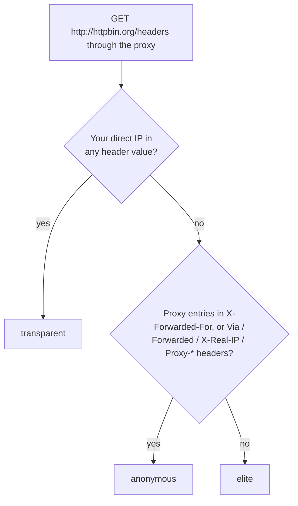

# ProxPulse

**English** | [Русский](README.ru.md)

[](https://github.com/nechel12/proxpulse/actions/workflows/ci.yml)
[](https://github.com/nechel12/proxpulse/releases)
[](https://github.com/nechel12/proxpulse/releases)
[](LICENSE)
[](#install)
[](src-tauri/Cargo.toml)
[](https://tauri.app/)
[](SECURITY.md)
[](https://github.com/nechel12/proxpulse/commits/main)
[](CONTRIBUTING.md)

Desktop proxy checker for Windows, Linux and macOS. It checks HTTP, HTTPS,
SOCKS4 and SOCKS5 proxies for liveness, latency, geolocation, anonymity,
content and TLS integrity, runs a local rotating HTTP/SOCKS5 dispatcher over
the alive pool, re-checks the pool on a schedule and posts it to webhooks.

Stack: **Tauri 2 + Rust (tokio, reqwest, rustls) + Vite + TypeScript**. All
network work, parsing and scheduling run in the Rust backend; the UI is a thin
TypeScript layer. Russian and English UI, picked from the system language on
first launch; dark and light themes.

> Status: pre-1.0. Settings, export formats and webhook payloads may change in
> minor releases; changes are listed in [CHANGELOG.md](CHANGELOG.md).


## Contents

- [Install](#install) · [Quick start](#quick-start)
- Checking: [Input formats](#input-formats) · [Check target](#check-target) ·
  [Check settings](#check-settings) · [Deep checks](#deep-checks) ·
  [How verdicts are decided](#how-verdicts-are-decided) · [Results table](#results-table) ·
  [Export](#export)
- [Dispatcher](#dispatcher) · [Scheduled checks and webhooks](#scheduled-checks-and-webhooks) ·
  [Settings, tray and updates](#settings-tray-and-updates)
- [Privacy and local data](#privacy-and-local-data) ·
  [Troubleshooting](#troubleshooting) · [Limitations](#limitations) ·
  [Security](#security)
- [Build from source](#build-from-source) · [Project structure](#project-structure) ·
  [Contributing](#contributing)

## Install

Builds for every platform are attached to each
[GitHub release](https://github.com/nechel12/proxpulse/releases):

| Platform | File | Updates |
|---|---|---|
| Windows x64 | `…_x64-setup.exe` — NSIS installer (recommended) | built-in |
| | `…_x64_en-US.msi` — MSI installer | manual |
| | `…-portable.exe` — no install | replace the file |
| Linux x64 | `…_amd64.AppImage` | built-in |
| | `…_amd64.deb`, `…x86_64.rpm` | package manager |
| macOS | `…_aarch64.dmg` (Apple Silicon), `…_x64.dmg` (Intel) | built-in |

`SHA256SUMS.txt` lists the checksum of every file (from the next release on);
`latest.json` and `.sig` files serve the built-in updater.

> [!NOTE]
> **Windows:** builds are not Authenticode-signed, so SmartScreen may show
> "Windows protected your PC": **More info → Run anyway**.
>
> **macOS:** builds are not signed with an Apple certificate. The app is opened
> through the context menu → **Open** on first launch, or with
> `xattr -cr ProxPulse.app`. The author has no Mac: macOS builds are verified by
> compilation only and are not guaranteed to work. Problem reports should
> include the diagnostics from the Settings tab.

## Quick start

1. Paste a proxy list in any format into **Source**, drop files on it, or
   import files or a URL. The counter shows how many proxies a check will test.
2. Pick a preset — **Standard** checks liveness plus every deep check,
   **Fast** liveness only — and press **Start** (Ctrl+Enter). Results stream
   in as proxies finish; **Stop** (Esc) aborts at once.
3. Export the alive proxies (**Export** → `.txt`, `.json`, `.csv` or **Copy**),
   or turn on the dispatcher and point a browser at `127.0.0.1:1080` as an
   HTTP or SOCKS5 proxy.
4. Optionally, the **Auto** tab re-checks the pool every N minutes and posts it
   to webhooks.

## Checking

### Input formats

The format is detected per line; scheme case does not matter:

- `127.0.0.1:8080`, `proxy.example.com:8080`, `[2001:db8::1]:8080`
- `user:pass@127.0.0.1:8080`
- `http://…`, `https://…` (TLS to the proxy), `socks5://…`, `socks5h://…`,
  `socks://…`, `socks4://…`, `socks4a://…`
- `127.0.0.1:8080:user:pass` and `user:pass:127.0.0.1:8080`
- `127.0.0.1:8080:socks5` (protocol as a suffix)
- CSV, tabs or spaces: `127.0.0.1,8080,user,pass`, `socks5,127.0.0.1,8080`
- JSON: an object, an array or a log with `host`/`ip`, `port`, `username`,
  `password`, `type` fields
- Numbered or bulleted lists (`1) …`, `- …`, `[x] …`), `# …` and `// …`
  comments, `ip:port` inside prose

Text files of any kind (TXT, CSV, JSON, LOG) and URLs (up to 2 MB, public
hosts only) are imported with the same parser. Every entry must normalize to a
proxy the checker can use, and one proxy written two ways counts once, so the
counter equals the number of proxies a check tests.

> [!NOTE]
> IPv6 addresses need square brackets (`[2001:db8::1]:8080`); the bare form is
> ambiguous and is not accepted. `socks4` cannot carry IPv6 or host names:
> `socks5` or `socks4a` is used for them.

### Check target

The **public server** mode requests a ready-made endpoint or a custom URL
through every proxy: `google`/`cloudflare` `generate_204` (fastest),
`api.ipify.org` and `httpbin.org/ip` (show the exit IP), `http://ip-api.com/json`
(exit IP and geo in one request), `example.com`, or **Custom URL…**. The URL
that will actually be requested is shown under the list.

The **ProxPulse Judge** mode uses a [ProxPulse Judge](https://github.com/nechel12/proxpulse-judge)
instance: the built-in public one at `https://proxycheck.lmtunnel.com` or a
custom server. **Fast** requests `/generate_204`; **Full** requests `/judge`,
which returns geo, IP type, anonymity and a content hash in one response and
replaces the deep checks.

> [!IMPORTANT]
> **An HTTPS judge cannot detect anonymity or integrity.** A request to an
> `https://` URL travels inside a TLS tunnel, where the proxy can neither add
> headers nor alter the response, so every proxy would look `elite`. Anonymity
> and integrity therefore stay empty with an HTTPS judge, and it does not
> receive your real IP (`direct_ip`). A self-hosted judge reached over `http://` detects
> both; it receives `direct_ip` to recognize proxies that forward it.

> [!NOTE]
> **ip-api: free tier and Pro.** The free endpoint is HTTP-only and limited to
> 45 requests per minute. With **ip-api Pro** and a key, requests use HTTPS:
> checked proxies cannot see the key, but ip-api receives it from the addresses
> of all of them, so a dedicated key is recommended and IP restrictions on the
> key do not work. The free tier is not for commercial use.

### Check settings

| Setting | Default | Meaning |
|---|---|---|
| Timeout | 5000 ms | limit for one request through the proxy (1000–30000) |
| Threads | 50 | proxies checked in parallel (1–500) |
| Samples | 1 | requests per proxy for ping, jitter and success rate (1–5); each opens a new connection, so ping includes connecting to the proxy |
| No-scheme type | HTTP | protocol for entries without a scheme; **HTTP + SOCKS5** tries both |
| Port precheck | on, 1500 ms | fast TCP connect that drops dead hosts before the full check |

Presets: **Fast** (liveness only), **Standard** (all deep checks),
**Deep** (ip-api, 3 samples), **Judge** (built-in judge, full mode). Editing
any setting turns the selection into a custom configuration; **+ Save**
stores it as a named preset.

### Deep checks

Deep checks run after a proxy is found alive and are off in Judge mode:

- **Geo and IP type** — country, city, ISP, organization, ASN and
  mobile/datacenter/residential, via ip-api.
- **Anonymity** — the headers `http://httpbin.org/headers?show_env=1` receives
  through the proxy, compared with your direct IP.
- **Integrity** — the `http://example.com` body compared with a direct request.
- **TLS** — the certificate fingerprint of `example.com:443` compared with a
  direct connection.

Anonymity and integrity use **plain HTTP**: only then does the proxy see the
request and get a chance to add headers or change the response. Proxies that
allow only CONNECT to port 443 cannot be classified this way.

At most 8 geo lookups and 64 of each other deep check run at once, and geo
pauses for a minute after ip-api answers 429. A check that hits a limit is
skipped instead of waiting and marked **limit**. The geo cache (2000 entries,
6-hour TTL) avoids repeated lookups for unchanged exit IPs.

### How verdicts are decided

| Column | Value | Meaning |
|---|---|---|
| Anon | `elite` | No proxy headers and no trace of your direct IP. |
| | `anon` | The proxy reveals itself (`Via`, its own `X-Forwarded-For` entries, `Forwarded`, `X-Real-IP`, `Proxy-*`) but not your IP. |
| | `transp` | Your direct IP appears in a forwarded header: the proxy leaks it. |
| TLS | `ok` / `mod` / `n/v` | The certificate matches / differs or is rejected / the handshake failed for another reason. |
| Info | `?mod`, `?tls` | The page through the proxy differs from the direct one / the TLS certificate differs. The row tooltip lists every result. |
| Anon, Geo, TLS | `—` | Not checked: off, unsupported by the proxy, or an HTTPS judge. |
| Anon, Geo, TLS | `limit` | Skipped at a concurrency limit; running the check again fills it. |



### Results table

The table shows every result, however long the list: only the rows in view
are drawn. A click on a column header sorts by it (ascending, descending,
off); the text filter (Ctrl+F) and the **Protocol**, **Anonymity** and
**Country** menus narrow the list. A click selects a row, Ctrl+click and
Shift+click select several, Ctrl+A selects all shown. Right-click opens
actions for the selection: copy (with credentials), re-check, add the alive
ones to the pool, remove from the list (also Delete). **Re-check dead** checks
only the dead proxies again and updates their rows in place.

### Export

**Export** saves `.txt` (normalized proxy URLs), `.json` (full results) or
`.csv` (table with the original line and URL) through the system dialog, or
copies the list. The **dead** toggle includes unavailable proxies. A sparkline
under the toolbar shows the average ping of alive proxies across checks.

## Dispatcher

The **Dispatcher** tab serves a local proxy on `127.0.0.1:1080` (or the next
free port) and routes traffic through the alive pool. One port accepts HTTP
and SOCKS5 (detected from the first byte), or only the selected protocol.

| Mode | Behavior |
|---|---|
| Rotation | starts at the next upstream for every connection; up to five attempts |
| Fastest | always the lowest-latency upstream; a single attempt |
| Failover | the lowest-latency upstream first, then the next ones; up to five attempts |

- An HTTPS tunnel (CONNECT) stays on one upstream until it closes; each plain
  HTTP request gets its own connection (`Connection: close`).
- SOCKS5 upstreams resolve site names themselves, so local DNS does not see
  visited domains (`socks4` cannot and resolves locally).
- The pool fills from every check (existing entries are kept), can be
  filtered, sorted, synced and cleared, and is saved to disk between launches.
- Request and error counters, the current upstream and the last error are
  shown live.

## Scheduled checks and webhooks

The **Auto** tab re-checks the shared pool every N minutes:

- Scheduled checks are light: liveness, ping and country; geo is requested
  only for entries without a country.
- A proxy leaves the pool after two failed checks in a row; **Max ping**
  removes slower ones (`0` — no limit).
- When no proxy answers and the check server is unreachable directly (offline,
  waking from sleep), the pool is left unchanged and the check is retried in a
  minute; a check crowded out by a manual one is retried the same way.
- Scheduled checks never stop the dispatcher.

With **Send after each auto-check**, the pool is POSTed to up to 10 webhooks
as TXT, JSON or CSV. Credentials are stripped unless **Send credentials** is
on, which requires an `https://` webhook. Webhooks must be public hosts;
redirects are not followed, and a non-2xx answer is shown as an error.

The scheduler and webhooks run in the backend, so they keep working while the
window is in the tray.

## Settings, tray and updates

The **Settings** tab holds the app-wide options:

- **General**: language, theme (dark, light or the system one), and hiding
  logins and passwords in the tables; exports and copies keep them.
- **Startup and tray**: what closing the window does (quit, or hide to the
  tray); starting with the system, optionally straight to the tray; starting
  the dispatcher at launch with the last port, mode and listener when the
  pool is not empty.
- **Updates and notifications**: the version and **Check for updates**, a
  quiet check at launch, and system notifications while the window is hidden:
  a scheduled webhook delivery failed, the pool became empty, an update is
  out.
- **Data**: export, import and reset of the settings as a JSON file (it holds
  webhook URLs and the ip-api key, and the pool with its credentials only when
  you choose so on export); **Copy** puts a diagnostics
  report (version, OS, install type, counters, recent errors) on the clipboard
  for bug reports; the error log.

**⇲** hides the window to the tray. The tray menu shows or hides the window,
toggles the dispatcher and shows the next scheduled check and the webhook
state. Unless closing is set to hide to the tray, closing the window quits the
app, including the dispatcher and scheduled checks.

Updates come from GitHub Releases; installation shows download progress and
restarts the app. MSI, portable, `.deb` and `.rpm` builds point to the
release page instead.

## Privacy and local data

Network requests leave the machine for: the selected check target; ip-api,
httpbin.org and example.com when deep checks are on; direct (no proxy)
baselines — your IP and the example.com reference — and a connectivity check
when a scheduled check finds no alive proxy; the selected judge; GitHub
Releases (update check, also at launch unless turned off); configured
webhooks; URL imports.

Proxy credentials go to the proxy itself (HTTP `Proxy-Authorization` or SOCKS
authentication), into exports, and to webhooks only with **Send credentials**.

Stored locally:

- In the WebView `localStorage`: language, theme, settings and presets,
  webhook URLs (may contain tokens), the ip-api Pro key, the geo cache
  (credential-free keys), ping history, recent errors.
- In `pool.json` in the app data directory (`%APPDATA%\com.nechel12.proxpulse`,
  `~/.local/share/com.nechel12.proxpulse`,
  `~/Library/Application Support/com.nechel12.proxpulse`): the pool **with
  usernames and passwords**, owner-only on Linux and macOS. **Clear pool**
  clears it. `prefs.json` next to it holds the startup options and the last
  dispatcher port, mode and listener.
- Starting with the system adds a login item: the `Run` registry key on
  Windows, a LaunchAgent on macOS, a `.desktop` file in `~/.config/autostart`
  on Linux. Turning the option off removes it.

## Troubleshooting

| Symptom | Cause and fix |
|---|---|
| Anon is `—` and the integrity result is missing in Judge mode | The judge is reached over HTTPS, where a proxy cannot add headers or change the body. A self-hosted judge over `http://` is required for these results. |
| Anon is `—` for working proxies | The proxy allows only CONNECT to port 443, so the plain-HTTP probes fail. Expected for HTTPS-only proxies. |
| **limit** in Geo, Anon or TLS | The concurrency limit or the ip-api 429 cooldown was hit. Fewer threads or a second run fill the gaps. |
| Many alive proxies without geo on free ip-api | The free tier allows 45 requests per minute. ip-api Pro or the judge removes the limit; the geo cache helps on repeated runs. |
| The source counter shows `!` | The input exceeds 10 MB, or parsing failed (the status line shows the error). |
| A line is not counted | It does not normalize to a proxy (bad port, bare IPv6, missing host) or is the same proxy as an earlier line. |
| Auto status: "Check server unreachable directly" | No network, or the check target is blocked without a proxy. The pool is kept and the check is retried in a minute. |
| Scheduled checks stop when the window is closed | Closing quits the app by default: **Settings → When the window is closed → Hide to tray**, or **⇲**, keeps it running. |
| No system notifications | They are shown only while the window is hidden or in the background, and the OS may block them for ProxPulse. |
| The dispatcher starts on 1081, 1082, … | The requested port is busy; the next free one is used and shown. |
| The browser gets `502 All upstreams failed` | Every tried upstream failed; the dispatcher status shows the last error. Re-checking the pool or switching to failover helps. |
| `Webhook error: http 4xx/5xx` | The receiver rejected the POST. Local and private hosts are blocked, and redirects are not followed. |
| macOS: "the app is damaged" | The build is unsigned: `xattr -cr ProxPulse.app`, then open it again. |

## Limitations

- Anonymity, integrity and IP type are heuristics: a proxy can withhold or
  forge headers.
- Header and content checks need plain HTTP: HTTPS-only proxies and an HTTPS
  judge yield no verdict.
- The TLS check compares the `example.com` leaf certificate with a direct
  connection; a legitimately different valid certificate (another CDN edge, a
  rotation) is reported as `mod`.
- ip-api and httpbin.org are shared public services with rate limits and
  outages; for regular use a self-hosted judge is more reliable.
- The dispatcher listens on `127.0.0.1` without authentication: any local
  process can use the pool.
- Webhook URLs, the ip-api key and the pool are stored unencrypted.
- Builds are not code-signed; macOS builds are compile-checked only.

## Security

Vulnerability reporting is described in [SECURITY.md](SECURITY.md); working
proxies, credentials and webhook URLs must not be posted in public issues.

ProxPulse is a diagnostic tool, not a security boundary. Proxies are untrusted
input: response sizes are capped, user-supplied URLs (webhooks, URL import)
are restricted to public hosts with DNS pinning (webhooks follow no redirects,
URL imports re-check every redirect), and credentials are sent to webhooks
only over HTTPS on request. Updates are
verified against the signing key embedded in the app.

## Build from source

Requirements: [Node.js](https://nodejs.org/) 22.12+, [Rust](https://rustup.rs/)
1.90+, WebView2 on Windows (preinstalled on Windows 10/11), WebKitGTK and the
packages below on Linux.

<details>
<summary>Linux build dependencies (Debian/Ubuntu)</summary>

```sh
sudo apt update
sudo apt install -y libwebkit2gtk-4.1-dev build-essential curl wget file \
  libxdo-dev libssl-dev libayatana-appindicator3-dev librsvg2-dev
```

</details>

```sh
npm ci
npm run tauri dev        # development with hot reload
npm run build:unsigned   # local release build without the updater key
```

`npm run tauri build` signs updater artifacts and needs
`TAURI_SIGNING_PRIVATE_KEY`, which only the release workflow has; builds from
`build:unsigned` are for local use and are never published as updates.

Checks (the same ones CI runs, plus an MSRV build, a Windows bundle smoke
test and `cargo audit`):

```sh
npm run build && npm test && npm run lint && npm run check:versions
cargo fmt --manifest-path src-tauri/Cargo.toml -- --check
cargo clippy --manifest-path src-tauri/Cargo.toml --all-targets -- -D warnings
cargo test --manifest-path src-tauri/Cargo.toml --lib
```

Releases follow [RELEASING.md](RELEASING.md).

## Project structure

```text
index.html                          # screen markup
src/main.ts                         # UI wiring
src/check-client.ts                 # check runs over a Tauri channel
src/source-panel.ts, parse-runner.ts # list input, import, backend parsing
src/settings-panel.ts, profiles*.ts # check settings and presets
src/results*.ts, virtual-rows.ts    # results table: sorting, filters, selection, virtual rows
src/format.ts                       # cell formatting
src/export*.ts, csv.ts              # TXT/JSON/CSV export
src/pool.ts, dispatch-monitor.ts    # pool view and dispatcher status
src/auto-*.ts, webhooks.ts          # schedule, its status and webhooks
src/app-settings.ts, settings-io.ts # Settings tab, settings export/import
src/theme.ts, notify.ts             # theme and system notifications
src/updater.ts, info-panel.ts       # updates and diagnostics
src/geocache.ts, geo-store.ts       # geo cache
src/i18n.ts                         # RU/EN strings
src/*.test.ts                       # frontend tests (vitest)
src-tauri/src/lib.rs                # backend entry, tray, shared types
src-tauri/src/commands/*.rs         # Tauri commands: check, dispatch, auto, webhook, …
src-tauri/src/extract.rs            # proxy extraction from text (the only parser)
src-tauri/src/proxy.rs              # proxy normalization
src-tauri/src/http.rs               # HTTP clients, body limits, deep-check probes
src-tauri/src/transport.rs          # SOCKS/HTTP CONNECT and TLS to proxies
src-tauri/src/tls.rs                # TLS config and certificate fingerprints
src-tauri/src/netguard.rs           # guard for user-supplied URLs
src-tauri/src/tests/*.rs            # backend tests
.github/workflows/ci.yml            # checks on every push and PR
.github/workflows/release.yml       # tagged release builds
```

## Related projects

- [ProxPulse Judge](https://github.com/nechel12/proxpulse-judge) — self-hosted
  check backend (Rust/axum, Docker): exit IP, anonymity, local geo/ASN and a
  tamper check in one request. Its public instance is the default judge here.

## Contributing

Bug reports and pull requests are welcome. The development workflow is
described in [CONTRIBUTING.md](CONTRIBUTING.md); participation implies
agreement with the [Code of Conduct](CODE_OF_CONDUCT.md). Bug reports should
include the version, OS and the diagnostics from the Settings tab — the issue form
asks for them. Security issues go through [SECURITY.md](SECURITY.md), not a
public issue. Changes are listed in [CHANGELOG.md](CHANGELOG.md).

## License

The code is licensed under Apache-2.0; the license text is in
[LICENSE](LICENSE). Third-party services used by the checks (ip-api,
httpbin.org, example.com, public judge instances) have their own terms.

---

## Support the project

ProxPulse is free and open source. If it saves time, further development can
be supported here:

<p align="center">
  <a href="https://boosty.to/nechel12/donate">
    
  </a>
</p>

### Crypto

| Network | Address |
|:--------|:--------|
| **TRON** | `TMM2Cdm4tJx1nKRRq5RCBcdwfn9cHuJZy9` |
| **TON** | `UQBlVvOfTleWn4pkY384mYWiGyhdHBryoC_N1Si1OSWAxPKl` |
| **Bitcoin** | `bc1qagjtnutjya2rss3u3ls8ur7qk0u7zutc6t6fwc` |
| **BNB Smart Chain** | `0x423aF840f67355371bf32480744A84069dfab5ff` |

> [!WARNING]
> Only the asset matching the specified network may be sent. Transfers to
> another network cannot be recovered.
