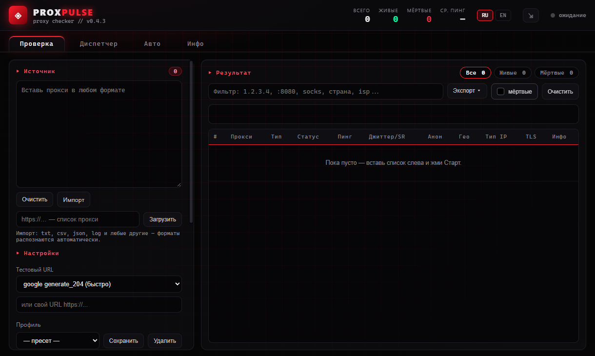

# ProxPulse

[](https://github.com/nechel12/proxpulse/releases) [](https://github.com/nechel12/proxpulse/releases) [](https://github.com/nechel12/proxpulse/actions/workflows/ci.yml)  [](src-tauri/Cargo.toml) [](https://tauri.app/) [](https://github.com/nechel12/proxpulse/commits/main) [](SECURITY.md) [](LICENSE)

*[English version](README_EN.md)*

ProxPulse — десктопный чекер прокси с обновлением результатов в реальном
времени: проверка доступности, задержки, геолокации, анонимности,
целостности трафика и TLS, локальный прокси-диспетчер, автоматические
проверки по таймеру и отправка рабочих прокси на вебхуки.

Стек: **Tauri 2 + Rust (tokio, reqwest, rustls) + Vite + TypeScript**.
Тёмная тема с красными акцентами; интерфейс на русском и английском языках
(при первом запуске выбирается по языку системы).

## Возможности

- Проверка доступности, задержки, джиттера и доли успешных запросов.
- Геолокация, тип IP, анонимность, целостность контента и TLS.
- HTTP, HTTPS (TLS до прокси), SOCKS5/SOCKS5h и SOCKS4/SOCKS4a.
- Локальный HTTP/SOCKS5-диспетчер: ротация, выбор быстрейшего и замена при падении.
- Автопроверки, пресеты настроек, экспорт TXT/JSON/CSV и вебхуки.
- Импорт из файлов и по URL, дедупликация, тёмная тема, RU/EN.
- Проверка обновлений и системный трей.

## Скриншоты



Английский интерфейс — в [README_EN.md](README_EN.md).

## Установка

Готовые сборки доступны в разделе [Releases](https://github.com/nechel12/proxpulse/releases):

- **Windows (x64):** установщик `-setup.exe` или `.msi`, портативный `.exe`;
- **Linux (x64):** `.AppImage`, `.deb`, `.rpm`;
- **macOS:** `.dmg` для Apple Silicon и Intel.

Встроенное автообновление работает для Windows NSIS (`-setup.exe`),
macOS и Linux AppImage. MSI, `.deb` и `.rpm` устанавливаются и обновляются
вручную (через установщик или пакетный менеджер). Портативные сборки
обновляются заменой файла. Выбор файла для каждой платформы описан в
примечаниях к релизу.

> **macOS:** сборки не подписаны сертификатом Apple. При первом запуске
> откройте приложение через контекстное меню → «Открыть» или выполните
> `xattr -cr ProxPulse.app`. Автор не имеет доступа к Mac: macOS-сборки
> проверены только успешной компиляцией, запуск не тестировался,
> работоспособность не гарантируется. При проблемах приложите диагностику
> из вкладки «Инфо».

## Сборка из исходников

Требования: [Node.js 22.12+](https://nodejs.org/), [Rust](https://rustup.rs/)
(stable, не ниже 1.90) и WebView2 (в Windows 10/11 уже установлен). Для
сборки под Linux нужны системные пакеты WebKitGTK и другие зависимости.

<details>
<summary>Системные зависимости Linux (Debian/Ubuntu)</summary>

```sh
sudo apt update
sudo apt install -y libwebkit2gtk-4.1-dev build-essential curl wget file \
  libxdo-dev libssl-dev libayatana-appindicator3-dev librsvg2-dev
```

</details>

```sh
npm install           # или npm ci для установки строго по package-lock.json
npm run tauri dev     # режим разработки
npm run tauri build   # релизная сборка; нужен TAURI_SIGNING_PRIVATE_KEY
npm run build:unsigned # локальная сборка без updater-артефактов и ключа
```

Релизная сборка подписывает updater-артефакты ключом из CI
(`TAURI_SIGNING_PRIVATE_KEY`). Для локальной сборки без доступа к ключу
используйте `npm run build:unsigned`: он отключает `createUpdaterArtifacts`
и не пытается подписывать установщик. Такую сборку нельзя использовать для
публикации обновлений — только для локального запуска/проверки.

Проверки:

```sh
npm run build         # tsc + vite build
npm test              # vitest: парсинг, пресеты, CSV, экспорт, i18n, форматирование
npm run lint          # ESLint
cargo fmt --manifest-path src-tauri/Cargo.toml -- --check
cargo test --manifest-path src-tauri/Cargo.toml --lib
cargo clippy --manifest-path src-tauri/Cargo.toml --all-targets -- -D warnings
npm run check:versions
```

CI (`.github/workflows/ci.yml`) запускает эти проверки при push в `main`
и при создании pull request, а также собирает release-бинарник без
установщика (`npm run build:unsigned -- --no-bundle`), чтобы поймать
несовпадения версий Tauri-пакетов и ошибки сборки.

## Проверка (вкладка «Проверка»)

Вставьте список в поле слева (по одному прокси на строку) и нажмите
**Старт**. Результаты появляются по мере завершения проверок. Кнопка
**Стоп** прерывает текущую проверку.

### Поддерживаемые форматы

Формат определяется автоматически; регистр схемы не важен:

- `127.0.0.1:8080`, `proxy.example.com:8080`, `[2001:db8::1]:8080`
- `user:pass@127.0.0.1:8080`
- `http://…`, `https://…`
- `socks5://…`, `socks5h://…`, `socks://…`
- `socks4://…`, `socks4a://…`
- `127.0.0.1:8080:user:pass` и обратный порядок `user:pass:127.0.0.1:8080`
- `127.0.0.1:8080:socks5` (протокол суффиксом)
- CSV, табы и пробелы: `127.0.0.1,8080,user,pass`
- JSON: объект, массив или лог с полями `host`, `port`, `username`, `password`
- Нумерованные списки (`1) …`, `- …`) и комментарии `# …`, `// …`

Дубликаты удаляются автоматически. Список можно импортировать из любого
текстового файла (TXT, CSV, JSON, LOG) или по URL: встроенный клиент
загружает до 2 МБ и обрабатывает данные тем же парсером.

> IPv6-адрес указывайте в квадратных скобках: `[2001:db8::1]:8080`.
> Форма без скобок неоднозначна и не поддерживается.

> `socks4` не поддерживает IPv6-литералы. Для IPv6 используйте `socks5`
> или `socks4a`; в `socks4a` IPv6 передаётся как доменное имя (best effort,
> поддержка зависит от прокси).

### Сервер проверки

Сервер выбирается в настройках проверки и бывает двух видов.

**Публичный сервер** — готовый эндпоинт или свой URL:

- `google generate_204`, `cloudflare generate_204` — быстрые, без тела;
- `api.ipify.org`, `httpbin.org/ip` — показывают IP выхода;
- `http://ip-api.com/json` — IP и геолокация одним запросом (free-tier только HTTP);
- `example.com` — обычная страница;
- **«Свой URL…»** — отдельный пункт списка: поле ввода появляется только при
  его выборе и не перекрывает остальные варианты. Под списком показан
  фактический URL, который уйдёт в проверку.

**ProxPulse Judge** — собственный бэкенд для проверок. По умолчанию
используется встроенный публичный инстанс `https://proxycheck.lmtunnel.com`;
пункт «Свой сервер…» открывает поле для другого инстанса. Режимы: **Быстрая** (`/generate_204`) и **Полная**
(`/judge` — геолокация, анонимность и тип IP в одном ответе, а также проверка
целостности по хешу контента). В режиме Judge глубокие проверки не
выполняются: их заменяет ответ Judge.

> **Judge по HTTPS не определяет анонимность и целостность.** Запрос к
> `https://` идёт внутри TLS-туннеля (CONNECT или SOCKS): прокси не видит его,
> не может добавить `Via`/`X-Forwarded-For` или изменить ответ, поэтому любой
> прокси выглядел бы `elite` и `ok`. В этом случае колонки «Анон» и
> «Целостность» остаются пустыми (`—`), гео и тип IP по-прежнему заполняются.
> Чтобы определять анонимность, укажите свой Judge по `http://`.
>
> Judge по HTTP получает в параметре `direct_ip` ваш реальный IP: так он
> замечает прокси, которые его пересылают. Judge по HTTPS этот параметр не
> получает — определить утечку он всё равно не может.

> **ip-api: бесплатный тариф и Pro.** Бесплатный ip-api работает только по
> HTTP: запросы и ваш IP видны прокси и сети, ответ может быть изменён по
> пути. Это осознанный компромисс; ответственность за использование
> бесплатного HTTP-эндпоинта лежит на пользователе. Pro-тариф открывает
> HTTPS и использует API-ключ (`https://pro.ip-api.com/...?key=...`,
> страница Pro: <https://members.ip-api.com/>). Включите «ip-api Pro» и
> укажите ключ в настройках проверки — тогда ip-api-запросы (и основной
> тестовый URL, и глубокий гео-запрос) пойдут по HTTPS.
>
> Запросы к ip-api выполняются **через проверяемый прокси**, поэтому прокси
> видит и сам ключ, и трафик. Используйте отдельный ключ для этого
> приложения; IP-ограничения ip-api при работе через прокси не помогут.
> Ключ хранится локально в `localStorage` (как и URL вебхуков) и попадает
> в экспорт только если вы сами его туда добавите. Не используйте
> бесплатный тариф для коммерческих задач — это ограничение ip-api.

### Настройки проверки

| Параметр | По умолчанию | Описание |
|---|---|---|
| Таймаут | 5000 мс | лимит одного HTTP-запроса (1000–30000) |
| Потоки | 50 | параллельных проверок (1–500) |
| Замеры | 1 | повторов на прокси для пинга, джиттера и доли успешных запросов (1–5); каждый замер открывает новое соединение, поэтому пинг включает подключение к прокси |
| Тип без схемы | HTTP | что подставлять, если схема не указана; режим HTTP + SOCKS5 проверяет оба варианта |
| Предварительная проверка порта | включена, 1500 мс | быстрый TCP-коннект: неработающие прокси отсеиваются до полной проверки |

Настройки объединены в пресеты: «Быстрая» (только живость), «Стандарт»
(все глубокие проверки), «Глубокая» (ip-api и 3 замера) и «Judge»
(встроенный Judge, полный режим). Пресет применяется одним кликом; ручная
правка любого параметра снимает выделение. Свои пресеты сохраняются кнопкой
«+ Сохранить» и удаляются крестиком. Таймаут, потоки, замеры, тип без схемы
и пречек находятся в раскрывающемся блоке «Параметры».

### Глубокие проверки (не используются в режиме Judge)

- **Геолокация и тип IP** — ip-api: страна, город, ISP, ORG, ASN,
  mobile/datacenter/residential.
- **Анонимность** — `elite` / `anonymous` / `transparent`: эвристика по
  заголовкам, которые видит `http://httpbin.org/headers?show_env=1`, и
  сравнение с прямым IP.
- **Целостность контента** — сравнение тела `http://example.com` с прямым
  соединением (`ok` / `modified`).

Анонимность и целостность проверяются **по обычному HTTP**: только так прокси
видит запрос и может добавить свои заголовки или подменить ответ. Через
`https://` прокси лишь туннелирует трафик, и такие проверки ничего бы не
показали. Прокси, разрешающие только CONNECT на порт 443, эти проверки не
проходят — колонка остаётся пустой.
- **Целостность TLS** — сравнение SHA256 сертификата example.com с прямым
  соединением (`ok` / `modified`).

Каждая глубокая проверка выполняет дополнительные запросы через прокси,
поэтому их можно отключать. В режиме Judge они не нужны: Judge возвращает
данные самостоятельно.

> **Ограничения публичных API.** ip-api (бесплатный тариф) ограничивает
> число запросов в минуту, httpbin.org тоже периодически throttled. Чтобы
> не заваливать ip-api при 500 потоках, одновременных гео-запросов не
> больше 8; анонимность, целостность и TLS также ограничены по
> параллельности. При перегрузке соответствующая глубокая проверка для
> части прокси пропускается (запустите проверку ещё раз). Гео-кэш (до 2000 записей, TTL 6 часов) уменьшает
> повторные запросы, но не заменяет собственный сервис. Для стабильной работы используйте
> самохостируемый [ProxPulse Judge](https://github.com/nechel12/proxpulse-judge).

Глубокие проверки — эвристики. Если baseline-запрос не удался, анонимность
может остаться пустой. TLS-проверка помечает `mod`, если сертификат был
отклонён, и `n/v` (`unverified`), если рукопожатие не прошло по другой
причине (например, прокси блокирует example.com:443).

### Экспорт

Меню **Экспорт**: `.txt` (нормализованные прокси, включая схему), `.json`
(полные результаты), `.csv` (таблица с исходной строкой и `url`),
**Скопировать**. Переключатель **«мёртвые»** определяет, включать ли
неработающие прокси в экспорт. Сохранение выполняется через
системный диалог.

Под таблицей отображается спарклайн среднего пинга рабочих прокси по
проверкам; история хранится локально.

## Диспетчер (вкладка «Диспетчер»)

Запускает локальный прокси на **127.0.0.1:1080** (порт по умолчанию) и
направляет трафик через рабочие прокси из проверки. Один порт принимает
**HTTP и SOCKS5** (протокол определяется по первому байту) или только
выбранный протокол. Если порт занят, выбирается следующий свободный
(+1, +2, …); фактический порт отображается в поле.

- Режимы: **ротация**, **самый быстрый**, **замена при падении** (failover).
  «Самый быстрый» делает одну попытку через лучший upstream; failover
  перебирает до пяти; ротация выбирает upstream при установлении соединения.
  HTTPS-туннель (CONNECT) идёт через один upstream до закрытия. Каждый
  обычный HTTP-запрос получает `Connection: close` и своё соединение: только
  так запрос к другому сайту не уйдёт в чужой туннель без авторизации.
- Для SOCKS5-апстримов (`socks5://` и `socks5h://`) имя сайта резолвит сам
  прокси, локальный DNS не видит посещаемые домены. `socks4://` не умеет
  передавать имена — для него резолв локальный, используйте `socks4a://`.
- Пул пополняется слиянием (старые записи сохраняются); кнопки
  «Синхронизировать» и «Очистить пул» (с подтверждением); фильтр и сортировка
  по пингу или стране.
- **Макс. пинг** (задаётся на вкладке «Авто»): прокси медленнее лимита не
  попадают в пул (`0` — без лимита).
- Счётчики запросов и ошибок, текущий вышестоящий прокси, последняя ошибка.
- Пул перепроверяется по расписанию из вкладки «Авто»; её статус виден и здесь.
- Пул сохраняется на диск и восстанавливается после перезапуска приложения.

## Авто (вкладка «Авто»)

Одно расписание перепроверяет общий пул каждые N минут. Автопроверка
облегчённая: живость, пинг и страна; гео запрашивается только для прокси
без страны, а анонимность, целостность и TLS не проверяются (их результаты
пулу не нужны). Прокси удаляется после двух неудачных автопроверок подряд.
Если не ответил ни один прокси, приложение проверяет прямой доступ к серверу
проверки: без него (нет сети, выход из сна) пул не меняется, а повтор
выполняется через минуту. Автопроверка не выключает диспетчер, даже если пул
опустел.

С включённой опцией **«Отправлять после автопроверки»** пул после каждой
проверки уходит POST-запросами на настроенные вебхуки (до 10, формат
TXT/JSON/CSV). Кнопки «Проверить сейчас» и «Отправить сейчас» запускают
действия вручную.

Планировщик и отправка вебхуков работают в Rust-бэкенде, поэтому
автопроверки продолжаются при свёрнутом в трей окне. Состояние вкл/выкл и
интервал сохраняются; после перезапуска расписание восстанавливается из
текущих настроек. Настройки двух прежних таймеров (диспетчер и авто)
при первом запуске объединяются в одно расписание.

По умолчанию логин/пароль прокси вырезаются из URL перед отправкой на
вебхук. Опция **«Отправлять логин/пароль»** включает передачу credentials,
но требует HTTPS; с `http://`-вебхуком отправка с credentials блокируется.

Ответ вебхука с кодом не из диапазона 2xx показывается как ошибка.
Вебхук должен указывать на публичный http(s)-хост: локальные и приватные
адреса блокируются, редиректы не выполняются.

## Инфо, трей и диагностика (вкладка «Инфо»)

- Ссылки на GitHub: ProxPulse и ProxPulse Judge.
- **Диагностика**: версия приложения, проверка обновлений через GitHub
  Releases, установка (на Windows установщик сам завершает приложение;
  на macOS/Linux после установки нужно перезапустить вручную), копирование
  отчёта (версия, счётчики, последние ошибки).
- Кнопка ⇲ в шапке сворачивает окно в системный трей. В меню трея:
  показать/скрыть окно, включить/выключить диспетчер с текущим портом,
  время до следующей автопроверки, состояние вебхука, выход. Нажатие ЛКМ
  по иконке показывает или скрывает окно.

## Приватность и локальные данные

При проверке наружу отправляются: запросы к выбранному тестовому URL;
при включённых глубоких проверках — запросы к ip-api, httpbin и example.com;
прямые запросы без прокси для эталонных значений (свой IP и эталон
example.com) и для проверки связи, если в автопроверке не ответил ни один
прокси; запросы к выбранному инстансу Judge; проверка релизов на
GitHub; POST на настроенные вебхуки; загрузка списка по URL.

Пароли прокси передаются самому прокси в рамках его протокола авторизации
(HTTP `Proxy-Authorization` или SOCKS authentication). Они также попадают
в экспорт (TXT/JSON/CSV/буфер обмена) и **только при явно включённой опции**
— в вебхук. По умолчанию вебхук получает URL без credentials.

Локально в браузере хранятся: язык, лимит пинга, URL вебхуков (могут
содержать токены), ключ ip-api Pro (если задан), кэш геоданных (до 2000
записей, ключи без credentials), последние ошибки, история пинга, текущие
настройки проверки, состояние автопроверок и пресеты настроек. Очистка
`localStorage` удаляет эти данные.

Пул диспетчера хранится в файле `pool.json` в каталоге данных приложения
(Windows: `%APPDATA%\com.nechel12.proxpulse`, Linux:
`~/.local/share/com.nechel12.proxpulse`, macOS:
`~/Library/Application Support/com.nechel12.proxpulse`). Файл содержит прокси
**вместе с логинами и паролями**; в Linux и macOS он доступен только
владельцу. Кнопка «Очистить» в пуле очищает и файл.

## Безопасность

Не публикуйте в issue рабочие прокси, пароли и другие секреты. Для сообщений
об уязвимостях используйте приватный канал GitHub Security Advisories:
[сообщить об уязвимости](https://github.com/nechel12/proxpulse/security/advisories/new).
Подробнее — в [SECURITY.md](SECURITY.md).

## Структура проекта

```text
index.html                         # разметка экранов
src/main.ts                        # точка сборки UI и обработчики
src/check-client.ts                # прогон проверок через Tauri Channel
src/source-panel.ts                # ввод и импорт списка
src/settings-panel.ts              # настройки проверки и ip-api Pro
src/profiles.ts, profiles-panel.ts # пресеты настроек
src/pool.ts                        # пул живых прокси
src/results.ts, format.ts          # таблица результатов и форматирование
src/csv.ts, export.ts              # экранирование и TXT/JSON/CSV-экспорт
src/export-panel.ts                # диалог сохранения и копирование
src/auto-settings.ts               # настройки автопроверок
src/auto-status.ts, auto-events.ts # статус и события автопроверок
src/webhooks.ts                    # панель вебхуков
src/dispatch-monitor.ts            # монитор локального диспетчера
src/updater.ts, info-panel.ts      # обновления и информация
src/parse.ts                       # парсинг прокси (чистые функции)
src/parse-runner.ts, parseWorker.ts # парсинг в worker с fallback
src/geocache.ts, geo-store.ts      # кэш геоданных
src/i18n.ts                        # словари RU/EN
src/*.test.ts                      # тесты чистых модулей (vitest)
src/styles.css                     # тёмная тема
src-tauri/src/lib.rs               # точка входа бэкенда
src-tauri/src/commands/*.rs        # команды Tauri (check, dispatch, auto, tray, ...)
src-tauri/src/http.rs              # HTTP-клиенты, лимиты тел, гео
src-tauri/src/proxy.rs             # парсинг/нормализация прокси
src-tauri/src/transport.rs         # SOCKS/HTTP CONNECT и TLS до прокси
src-tauri/src/tls.rs               # TLS-конфиг и отпечатки сертификатов
src-tauri/src/netguard.rs          # SSRF-гард для пользовательских URL
src-tauri/src/tests/*.rs           # тесты бэкенда
src-tauri/src/main.rs              # точка входа приложения
src-tauri/tauri.conf.json          # конфигурация Tauri
src-tauri/Cargo.toml               # зависимости Rust
eslint.config.js                   # ESLint
.github/workflows/ci.yml           # тесты, clippy и проверка версий
.github/workflows/release.yml      # релизные сборки и автообновление
scripts/check-versions.mjs         # синхронизация версий
```

## Связанные проекты

- [ProxPulse Judge](https://github.com/nechel12/proxpulse-judge) — самостоятельно
  размещаемый бэкенд для проверок (Rust/axum, Docker). Публичный инстанс
  используется в режиме Judge по умолчанию.

## Как помочь

Сообщения об ошибках и пул-реквесты приветствуются. В отчёте об ошибке
укажите версию приложения, операционную систему и диагностику из вкладки
«Инфо» — шаблон issue подскажет поля. Перед отправкой PR выполните все
проверки из раздела «Сборка из исходников»; подробности — в
[CONTRIBUTING.md](CONTRIBUTING.md), история изменений — в
[CHANGELOG.md](CHANGELOG.md), правила общения — в
[CODE_OF_CONDUCT.md](CODE_OF_CONDUCT.md).

Трекер задач: [Issues](https://github.com/nechel12/proxpulse/issues).

## Лицензия

Apache-2.0. См. [LICENSE](LICENSE).
