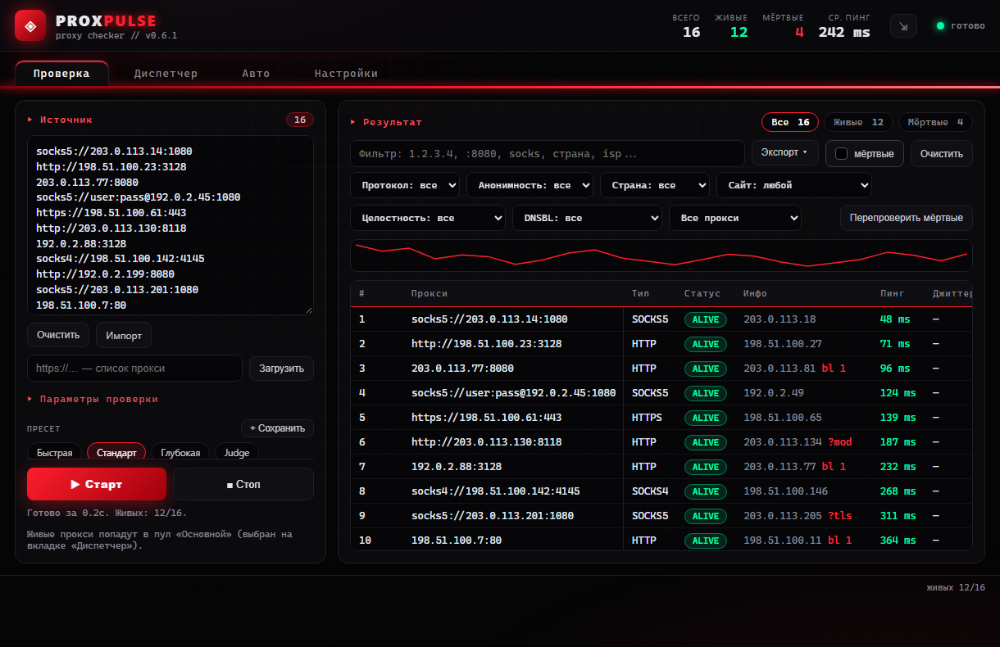
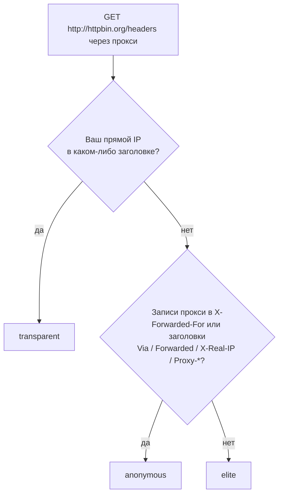

# ProxPulse

[English](README.md) | **Русский**

[](https://github.com/nechel12/proxpulse/actions/workflows/ci.yml)
[](https://github.com/nechel12/proxpulse/releases)
[](https://github.com/nechel12/proxpulse/releases)
[](LICENSE)
[](#установка)
[](src-tauri/Cargo.toml)
[](https://tauri.app/)
[](SECURITY.md)
[](https://github.com/nechel12/proxpulse/commits/main)
[](CONTRIBUTING.md)

Десктопный чекер прокси для Windows, Linux и macOS. Проверяет HTTP-, HTTPS-,
SOCKS4- и SOCKS5-прокси на доступность, задержку, геолокацию, анонимность,
целостность контента и TLS и наличие IP в чёрных списках, хранит живые в
именованных пулах, поднимает для каждого пула локальный HTTP/SOCKS5-диспетчер
с ротацией, отдаёт прокси скриптам через локальное API, перепроверяет пулы по
расписанию и отправляет их на вебхуки.

Стек: **Tauri 2 + Rust (tokio, reqwest, rustls) + Vite + TypeScript**. Вся
сетевая работа, разбор списков и планировщик работают в Rust-бэкенде;
интерфейс — тонкий слой на TypeScript. Интерфейс на русском и английском,
при первом запуске язык выбирается по системе; тёмная и светлая темы.

> Статус: pre-1.0. Настройки, форматы экспорта и вебхуков могут меняться в
> минорных релизах; изменения перечислены в [CHANGELOG.md](CHANGELOG.md).



## Содержание

- [Установка](#установка) · [Быстрый старт](#быстрый-старт)
- Проверка: [Форматы списка](#форматы-списка) · [Сервер проверки](#сервер-проверки) ·
  [Настройки проверки](#настройки-проверки) · [Глубокие проверки](#глубокие-проверки) ·
  [Как выносится вердикт](#как-выносится-вердикт) · [Таблица результатов](#таблица-результатов) ·
  [Экспорт](#экспорт)
- [Диспетчер](#диспетчер) · [Именованные пулы](#именованные-пулы) · [API пула](#api-пула) ·
  [Автопроверки и вебхуки](#автопроверки-и-вебхуки) ·
  [Настройки, трей и обновления](#настройки-трей-и-обновления)
- [Приватность и локальные данные](#приватность-и-локальные-данные) ·
  [Частые проблемы](#частые-проблемы) · [Ограничения](#ограничения) ·
  [Безопасность](#безопасность)
- [Сборка из исходников](#сборка-из-исходников) · [Структура проекта](#структура-проекта) ·
  [Как помочь](#как-помочь)

## Установка

Сборки для всех платформ прикреплены к каждому
[релизу на GitHub](https://github.com/nechel12/proxpulse/releases):

| Платформа | Файл | Обновление |
|---|---|---|
| Windows x64 | `…_x64-setup.exe` — установщик NSIS (рекомендуется) | встроенное |
| | `…_x64_en-US.msi` — установщик MSI | вручную |
| | `…-portable.exe` — без установки | заменой файла |
| Linux x64 | `…_amd64.AppImage` | встроенное |
| | `…_amd64.deb`, `…x86_64.rpm` | пакетным менеджером |
| macOS | `…_aarch64.dmg` (Apple Silicon), `…_x64.dmg` (Intel) | встроенное |

В `SHA256SUMS.txt` — контрольные суммы всех файлов; `latest.json` и `.sig`
нужны встроенному обновлению. Теги релизов начиная с 0.6.0 подписаны SSH-ключом
из [`docs/proxpulse-release.pub`](docs/proxpulse-release.pub); как проверить
подпись, описано в [RELEASING.md](RELEASING.md).

> [!NOTE]
> **Windows:** сборки не подписаны сертификатом Authenticode, поэтому
> SmartScreen может показать «Windows защитила ваш компьютер»:
> **Подробнее → Выполнить в любом случае**.
>
> **macOS:** сборки не подписаны сертификатом Apple. При первом запуске
> приложение открывается через контекстное меню → **Открыть** или после
> `xattr -cr ProxPulse.app`. У автора нет Mac: macOS-сборки проверены только
> компиляцией, работа не гарантируется. К сообщению о проблеме прикладывается
> диагностика из вкладки «Настройки».

## Быстрый старт

1. Список прокси в любом формате вставляется в поле **Источник**,
   перетаскивается на него файлами или импортируется из файлов и по URL.
   Счётчик показывает, сколько прокси будет проверено.
2. Выбирается пресет — **Стандарт** проверяет доступность и все глубокие
   проверки, **Быстрая** только доступность — и нажимается **Старт**
   (Ctrl+Enter). Результаты появляются по мере проверки; **Стоп** (Esc)
   прерывает её сразу.
3. Живые прокси экспортируются (**Экспорт** → `.txt`, `.json`, `.csv` или
   **Скопировать**), либо включается диспетчер: в браузере указывается
   `127.0.0.1:1080` как HTTP- или SOCKS5-прокси.
4. При необходимости вкладка **Авто** перепроверяет пул каждые N минут и
   отправляет его на вебхуки.

## Проверка

### Форматы списка

Формат определяется для каждой строки; регистр схемы не важен:

- `127.0.0.1:8080`, `proxy.example.com:8080`, `[2001:db8::1]:8080`
- `user:pass@127.0.0.1:8080`
- `http://…`, `https://…` (TLS до прокси), `socks5://…`, `socks5h://…`,
  `socks://…`, `socks4://…`, `socks4a://…`
- `127.0.0.1:8080:user:pass` и `user:pass:127.0.0.1:8080`
- `127.0.0.1:8080:socks5` (протокол суффиксом)
- CSV, табы и пробелы: `127.0.0.1,8080,user,pass`, `socks5,127.0.0.1,8080`
- JSON: объект, массив или лог с полями `host`/`ip`, `port`, `username`,
  `password`, `type`
- Нумерованные и маркированные списки (`1) …`, `- …`, `[x] …`), комментарии
  `# …` и `// …`, `ip:порт` внутри текста

Текстовые файлы любого вида (TXT, CSV, JSON, LOG) и URL (до 2 МБ, только
публичные хосты) разбираются тем же парсером. Каждая запись должна
нормализоваться в прокси, пригодный для проверки, а один прокси, записанный
двумя способами, считается один раз, поэтому счётчик равен числу прокси,
которые проверит проверка.

> [!NOTE]
> IPv6-адрес указывается в квадратных скобках (`[2001:db8::1]:8080`); форма без
> скобок неоднозначна и не принимается. `socks4` не умеет передавать IPv6 и
> имена хостов: для них используется `socks5` или `socks4a`.

### Сервер проверки

Режим **«Публичный сервер»** запрашивает через каждый прокси готовый эндпоинт
или свой URL: `google`/`cloudflare` `generate_204` (быстрее всего),
`api.ipify.org` и `httpbin.org/ip` (показывают IP выхода),
`http://ip-api.com/json` (IP выхода и гео одним запросом), `example.com` или
**Свой URL…**. Под списком показан URL, который фактически уйдёт в проверку.

Режим **ProxPulse Judge** использует инстанс
[ProxPulse Judge](https://github.com/nechel12/proxpulse-judge): встроенный
публичный (`proxycheck.lmtunnel.com`) или свой сервер, который вводится как
хост (`judge.example.com`, при необходимости с портом или путём). **Быстрая**
проверяет только доступность (`/generate_204`); **Полная** запрашивает
`/judge` — гео, тип IP, анонимность и хеш содержимого — и заменяет глубокие
проверки. Галочки **HTTPS** и **HTTP** определяют, как идут запросы к Judge:

| Выбор | Через каждый прокси | Результат |
|---|---|---|
| HTTPS + HTTP (по умолчанию) | `https://…/judge`, затем `http://…/judge` | доступность, пинг и гео по HTTPS; анонимность и целостность по HTTP |
| HTTPS | `https://…/judge` | доступность, пинг и гео; без анонимности и целостности |
| HTTP | `http://…/judge` | всё по HTTP; прокси, пропускающие только порт 443, выглядят мёртвыми |

> [!IMPORTANT]
> **Анонимность определяется только по обычному HTTP.** Внутри HTTPS-туннеля
> прокси не может ни добавить заголовки, ни изменить ответ, поэтому любой
> прокси выглядел бы `elite`. По HTTP прокси видит запрос — и мог бы
> переписать ответ. Judge подписывает каждый ответ `/judge` вместе со случайным
> nonce и вашим прямым IP; ProxPulse берёт ключ Judge напрямую, не через прокси
> (по HTTPS, если Judge его поддерживает, иначе по HTTP). Ответ, не прошедший
> проверку, помечается `?mod`, и его вердикт анонимности отбрасывается; перед
> этим ProxPulse один раз за запуск запрашивает ключ заново на случай, если
> Judge перезапустился с новым ключом. Judge без `/key` используется без
> подписи. Если ключ получить не удалось, ответы помечаются `?unv`; если ключ
> пришёл по обычному HTTP, под строкой статуса появляется примечание: такая
> подпись защищает от проверяемого прокси, но не от тех, кто на вашем пути к
> Judge. Прямой IP (`direct_ip`) уходит только в HTTP-запросах. Judge,
> перенаправляющий HTTP на HTTPS (как Render), и прокси, пропускающие только порт
> 443, анонимности не дают; прокси при этом остаётся живым.

Свой Judge для анонимности должен отвечать по обычному HTTP (например,
`docker run -p 80:8000 -e TRUST_PROXY=0 ghcr.io/nechel12/proxpulse-judge`
на сервере с публичным IP: прокси подключаются к нему из интернета). Он
подписывает ключом, сгенерированным при запуске; `SIGNING_KEY` нужен, только
чтобы использовать один ключ на нескольких репликах или сохранять его между
перезапусками. По возможности отдавайте `/key` и по HTTPS: ключ, полученный по
обычному HTTP, может подменить любой на вашем пути к Judge. Подробности — в
[README Judge](https://github.com/nechel12/proxpulse-judge/blob/main/README.ru.md#подпись-ответов).

> [!NOTE]
> **ip-api: бесплатный тариф и Pro.** Бесплатный эндпоинт работает только по
> HTTP и ограничен 45 запросами в минуту. С **ip-api Pro** и ключом запросы
> идут по HTTPS: проверяемые прокси ключ не видят, но ip-api получает его с
> адресов всех этих прокси, поэтому рекомендуется отдельный ключ, а
> IP-ограничения ключа не работают. Бесплатный тариф не предназначен для
> коммерческого использования.

### Настройки проверки

| Параметр | По умолчанию | Значение |
|---|---|---|
| Таймаут | 5000 мс | лимит одного запроса через прокси (1000–30000) |
| Потоки | 50 | прокси, проверяемых параллельно (1–500) |
| Замеры | 1 | запросов на прокси для пинга, джиттера и доли успешных (1–5); каждый открывает новое соединение, поэтому пинг включает подключение к прокси |
| Тип без схемы | HTTP | протокол для записей без схемы; **HTTP + SOCKS5** пробует оба |
| Пречек порта | вкл., 1500 мс | быстрый TCP-коннект, отсеивающий мёртвые хосты до полной проверки |

Пресеты: **Быстрая** (только доступность), **Стандарт** (все глубокие
проверки), **Глубокая** (ip-api, 3 замера), **Judge** (встроенный Judge,
полный режим). Любая ручная правка превращает выбор в собственную
конфигурацию; **+ Сохранить** сохраняет её как именованный пресет.

### Глубокие проверки

Глубокие проверки выполняются после того, как прокси оказался живым, и
отключены в режиме Judge:

- **Гео и тип IP** — страна, город, ISP, организация, ASN и
  mobile/datacenter/residential через ip-api.
- **Анонимность** — заголовки, которые `http://httpbin.org/headers?show_env=1`
  получает через прокси, в сравнении с вашим прямым IP.
- **Целостность** — тело `http://example.com` в сравнении с прямым запросом.
- **TLS** — отпечаток сертификата `example.com:443` в сравнении с прямым
  соединением.

Анонимность и целостность проверяются **по обычному HTTP**: только так прокси
видит запрос и может добавить заголовки или изменить ответ. Прокси,
разрешающие только CONNECT на порт 443, так классифицировать нельзя.

**Доступ к сайтам** запрашивает выбранные сайты (Google, YouTube, Telegram,
Discord, ChatGPT или свои хосты и URL, до 8) через каждый живой прокси, в
том числе в режиме Judge. Любой HTTP-ответ означает, что сайт доступен;
колонка **Сайты** показывает, сколько открылось, а подсказка — каждый сайт
со временем ответа.

**Чёрные списки (DNSBL)** выключены по умолчанию (**Чёрные списки IP
(DNSBL)** в блоке **Доступ к сайтам**). Они проверяют IP выхода в Spamhaus
ZEN, Barracuda, SpamCop и DroneBL, в том числе в режиме Judge (только IPv4,
кэш на час). Автопроверки их пропускают. `bl N` в колонке «Инфо» значит, что
IP есть в N списках; подсказка называет их, а фильтр показывает чистые или
попавшие в списки прокси. Запросы идут через ваш DNS-резолвер, поэтому
операторы списков видят проверяемые IP выхода. Список, не ответивший за 4 с,
считается неизвестным. Spamhaus не отвечает крупным публичным резолверам
(Google, Cloudflare, Quad9): с таким DNS его ответ считается неизвестным, а
не чистым.

Одновременно выполняется не больше 8 гео-запросов и 64 проверок каждого
другого вида, а после ответа 429 от ip-api гео на минуту приостанавливается.
Проверка, упёршаяся в лимит, не ждёт, а пропускается и помечается
**лимит** (пропущенная проверка по чёрным спискам видна только в подсказке
строки). Гео-кэш (2000 записей, TTL 6 часов) избавляет от повторных
запросов для неизменных IP выхода.

### Как выносится вердикт

| Колонка | Значение | Смысл |
|---|---|---|
| Анон | `elite` | Ни заголовков прокси, ни следов вашего прямого IP. |
| | `anon` | Прокси выдаёт себя (`Via`, свои записи в `X-Forwarded-For`, `Forwarded`, `X-Real-IP`, `Proxy-*`), но не ваш IP. |
| | `transp` | Ваш прямой IP есть в пересланном заголовке: прокси его раскрывает. |
| TLS | `ok` / `mod` / `n/v` | Сертификат совпал / отличается или отклонён / рукопожатие не удалось по другой причине. |
| Инфо | `?mod`, `?tls` | Страница через прокси отличается от прямой или не прошла проверку подписи Judge / сертификат TLS отличается. Все результаты — во всплывающей подсказке строки. |
| Инфо | `?unv` | Ключ Judge получить не удалось, поэтому подпись ответа не проверена. |
| Инфо | `bl N` | IP выхода есть в N чёрных списках; подсказка называет их. |
| Анон, Гео, TLS | `—` | Не проверялось: отключено, не поддерживается прокси или Judge по HTTPS. |
| Анон, Гео, TLS | `лимит` | Пропущено из-за лимита параллельных запросов; повторная проверка заполнит ячейку. |



### Таблица результатов

Таблица показывает все результаты при любой длине списка: рисуются только
видимые строки. Щелчок по заголовку колонки сортирует по ней (по
возрастанию, по убыванию, без сортировки); текстовый фильтр (Ctrl+F) и меню
**Протокол**, **Анонимность**, **Страна** и **Целостность** сужают список.
Колонка «Инфо» сразу после «Статуса» показывает выходной IP, метки ниже и
причину, по которой прокси мёртв; номер строки и прокси остаются на месте при
прокрутке таблицы вбок, а у каждого заголовка колонки есть подсказка. Щелчок выделяет
строку, Ctrl+щелчок и Shift+щелчок — несколько, Ctrl+A — все показанные.
Правая кнопка открывает действия для выделенных: копировать (с логинами и
паролями), перепроверить, тест скорости, добавить живые в пул, убрать из
списка (также Delete). **Перепроверить мёртвые** проверяет заново только
мёртвые прокси и обновляет их строки на месте.

- **Группировка** оставляет самый быстрый прокси на каждый IP выхода или ASN;
  прокси с общим IP выхода помечены ×N в колонке «Инфо».
- **Тест скорости** загружает 1–25 МБ (задаётся в параметрах проверки) с
  `speed.cloudflare.com` через прокси, до трёх одновременно, и показывает
  Мбит/с; в подсказке — время подключения, TLS и первого байта.
- **Аптайм** — доля проверок (ручных и автоматических), в которых прокси был
  жив; в подсказке — число проверок, когда он был жив в последний раз и
  средний пинг. Пул можно сортировать по надёжности, которая меньше доверяет
  прокси с малым числом проверок.

### Экспорт

**Экспорт** берёт строки, которые показывает таблица, с её фильтрами,
группировкой и порядком (строка статуса пишет «N из M», если фильтры что-то
скрыли). Он сохраняет `.txt` (нормализованные URL прокси), `.json` (полные
результаты) или `.csv` (таблица с исходной строкой и URL; в колонке `dnsbl` —
списки, где есть IP выхода, `clean` или пусто, если проверки не было) через
системный диалог либо копирует список. Также экспортируются конфиги для
прокси-клиентов, быстрые первыми: Clash (группа `url-test`; без SOCKS4),
sing-box (outbound `urltest`), профиль Proxifier с правилом по умолчанию
через самый быстрый прокси (без HTTPS-прокси) и PAC-файл (до 50 прокси, затем
`DIRECT`; PAC не умеет логины). **По шаблону** пишет строку на прокси из
подстановок вроде `{scheme}://{user}:{pass}@{host}:{port}`. Переключатель **мёртвые** добавляет
недоступные прокси. Спарклайн под панелью инструментов показывает средний
пинг живых прокси по проверкам.

## Диспетчер

Вкладка **Диспетчер** поднимает локальный прокси на `127.0.0.1:1080` (или
следующем свободном порту) и направляет трафик через пул живых прокси. Один
порт принимает HTTP и SOCKS5 (определяется по первому байту) или только
выбранный протокол.

| Режим | Поведение |
|---|---|
| Ротация | для каждого соединения начинает со следующего апстрима; до пяти попыток |
| Самый быстрый | всегда апстрим с наименьшей задержкой; одна попытка |
| Замена при падении | сначала самый быстрый апстрим, затем следующие; до пяти попыток |

- HTTPS-туннель (CONNECT) идёт через один апстрим до закрытия; каждый
  обычный HTTP-запрос получает своё соединение (`Connection: close`).
- SOCKS5-апстримы сами резолвят имена сайтов, поэтому локальный DNS не видит
  посещаемые домены (`socks4` так не умеет и резолвит локально).
- Пул пополняется после каждой проверки (старые записи сохраняются),
  фильтруется, сортируется, синхронизируется, очищается и сохраняется на диск
  между запусками.
- Счётчики запросов и ошибок, текущий апстрим и последняя ошибка обновляются
  в реальном времени.

Блок **Фильтр, сессии и вход** применяется сразу и сохраняется до
следующего запуска:

- **Страны апстримов** — только прокси из этих стран (коды или названия, как
  в пуле); пусто — все.
- **Липкая сессия** — один апстрим на сайт в течение N минут, чтобы входы и
  корзины не прыгали между IP выхода.
- Апстрим, к которому не удалось подключиться, пропускается минуту (счётчик
  **Пауза**), если есть другие.
- **Логин** — локальные клиенты должны авторизоваться: HTTP
  `Proxy-Authorization: Basic` (браузер спросит) или логин и пароль SOCKS5.

### Именованные пулы

Меню вверху вкладок **Диспетчер** и **Авто** переключает до десяти пулов,
например «скрапинг» и «работа»; **+**, **✎** и **✕** создают, переименовывают
и удаляют их. У каждого пула свои прокси, диспетчер (порт, режим, фильтр,
сессии и вход), расписание, максимальный пинг, подписки и вебхуки.

- Живые прокси из ручной проверки попадают в показанный пул.
- Расписание каждого пула работает, какой бы пул ни был показан. Проверка
  идёт одна за раз: пулы с одновременным сроком ждут очереди.
- Диспетчеру каждого пула нужен свой порт. Диспетчер никогда не использует
  диспетчер другого пула как апстрим.
- **Запускать диспетчер** при старте запускает диспетчеры всех пулов,
  которые запускались раньше. Трей показывает основной пул и управляет им.
- Удаление пула выключает его диспетчер и удаляет расписание и прокси.

### API пула

**API пула** на вкладке «Диспетчер» отдаёт живые прокси скриптам по HTTP на
`127.0.0.1:1090` (порт можно сменить). Включённый API запускается вместе с
приложением.

| Запрос | Ответ |
|---|---|
| `GET /random` | случайный прокси |
| `GET /fastest` | прокси с наименьшим пингом |
| `GET /list` | все подходящие прокси, по одному в строке |
| `GET /pools` | пулы: id, название и размер через табуляцию |
| `GET /` | краткая справка |

| Параметр | Смысл |
|---|---|
| `pool` | id или название пула (регистр не важен); по умолчанию основной |
| `country` | коды или названия стран, как в пуле, через запятую |
| `proto` | `http`, `https`, `socks4`, `socks5` или `socks` (оба SOCKS) |
| `limit` | 1–20000 прокси из `/list` (по умолчанию все); `/random` и `/fastest` его не учитывают |
| `format` | `txt` (по умолчанию) или `json`: объекты с `url`, `scheme`, `host`, `port`, `country`, `latency` |

```sh
curl "http://127.0.0.1:1090/random?country=DE&proto=socks5"
curl -u user:pass "http://127.0.0.1:1090/list?pool=work&format=json&limit=20"
```

- Прокси отдаются как URL **вместе с логинами и паролями**.
- Пул с логином диспетчера отвечает только с тем же логином (HTTP Basic,
  `curl -u`), и `/pools` показывает его только тогда. Без логина его может
  прочитать любой локальный процесс.
- Апстримы на паузе после сбоя не выдаются, если есть другие подходящие.
- Ошибки: `400` — неверный параметр, `404` — нет подходящих прокси,
  неизвестный пул или путь, `405` — метод не `GET`.
- Запросы, у которых `Host` не `127.0.0.1` и не `localhost`, отклоняются,
  чтобы веб-страница не прочитала пул через DNS rebinding.

## Автопроверки и вебхуки

Вкладка **Авто** перепроверяет пул каждые N минут; у каждого
[именованного пула](#именованные-пулы) своё расписание:

- Автопроверка облегчённая: доступность, пинг и страна; гео запрашивается
  только для записей без страны.
- Прокси удаляется из пула после двух неудачных проверок подряд; если задан
  **Макс. пинг** (`0` — без лимита), так же считаются две проверки подряд
  медленнее него.
- Проверка, в которой не ответило больше половины пула (не меньше трёх
  прокси), не меняет ни пул, ни историю и сообщает об этом: чаще это проблема
  на этом компьютере (перегруженный канал, VPN или файрвол, закрывший порты
  прокси), чем гибель прокси. Применяется она, только если следующая проверка
  покажет то же. Перед удалением записей пул копируется в `pool.json.bak` (см.
  [Приватность и локальные данные](#приватность-и-локальные-данные)).
- Если не ответил ни один прокси, а сервер проверки недоступен напрямую (нет
  сети, выход из сна), пул не меняется, а проверка повторяется через минуту;
  так же повторяется проверка, пропущенная из-за ручной.
- Автопроверка никогда не выключает диспетчер.
- **Подписки** — до 10 URL со списками прокси скачиваются перед каждой
  автопроверкой; прокси, которых ещё нет в пуле, проверяются вместе с ним, и
  живые попадают в пул. Статус показывает, сколько было в каждом списке и
  сколько из них новых.

С опцией **Отправлять после автопроверки** пул уходит POST-запросом на
вебхуки (до 10) в формате TXT, JSON, CSV, сообщением Telegram или Discord
либо по своему шаблону (`{count}`, `{time}`, `{proxies}`, `{proxies_json}`,
`{added}`, `{removed}` и другие; шаблон, начинающийся с `{` или `[`, уходит
как JSON). **Только изменения** отправляет лишь добавленные и удалённые
прокси, а без изменений не отправляет ничего. Отправка после автопроверки при
сетевой ошибке, 429 или 5xx повторяется через 5 и 20 секунд. Логины и пароли
вырезаются, если не включена опция **Отправлять логин/пароль**, а она требует
вебхук по `https://`. Вебхук должен быть публичным хостом; редиректы не
выполняются, а ответ с кодом не из 2xx показывается как ошибка.

Планировщик и вебхуки работают в бэкенде, поэтому продолжают работать, пока
окно свёрнуто в трей.

## Настройки, трей и обновления

На вкладке **«Настройки»** собраны общие параметры приложения:

- **Общие**: язык, тема (тёмная, светлая или как в системе) и скрытие
  логинов и паролей в таблицах; в экспорте и при копировании они остаются.
- **Запуск и трей**: что делает закрытие окна (выход или сворачивание в
  трей); запуск вместе с системой, по желанию сразу в трей; запуск диспетчера
  при старте с последними портом, режимом и протоколом, если пул не пуст.
- **Обновления и уведомления**: версия и **Проверить обновления**, тихая
  проверка при запуске и системные уведомления, пока окно скрыто: вебхук
  автопроверки не отправлен, в пуле меньше заданного числа прокси, у
  автопроверки нет сети, вышло обновление. Если пулов несколько, заголовок
  называет пул.
- **Данные**: экспорт, импорт и сброс настроек в JSON-файл (в нём адреса
  вебхуков, ключ ip-api, логины диспетчеров и настройки именованных пулов, а
  пулы с логинами и паролями — только если выбрать это при экспорте; импорт
  добавляет пулы из файла, пока их всего не станет десять; запущенные
  диспетчеры сразу получают логин и фильтр стран из импорта или сброса);
  **Копировать** кладёт в буфер отчёт диагностики (версия, ОС, тип установки,
  счётчики, последние ошибки) для сообщений об ошибках; журнал ошибок; очистка
  истории прокси.

**⇲** сворачивает окно в трей. Меню трея показывает и скрывает окно,
включает диспетчер и показывает время до автопроверки и состояние вебхука.
Если закрытие не настроено на сворачивание в трей, закрытие окна завершает
приложение вместе с диспетчером и автопроверками.

Обновления берутся из GitHub Releases; установка показывает прогресс
загрузки и перезапускает приложение. Для MSI, портативной сборки, `.deb` и
`.rpm` открывается страница релиза.

## Приватность и локальные данные

Сетевые запросы уходят: к выбранному серверу проверки; к ip-api,
httpbin.org и example.com при включённых глубоких проверках; напрямую (без
прокси) за эталонами — ваш IP и эталон example.com — и для проверки связи,
если автопроверка не нашла живых прокси; к выбранному Judge; к GitHub
Releases (проверка обновлений, в том числе при запуске, если она не
выключена); на настроенные вебхуки; при импорте по URL и для подписок; к
выбранным сайтам через каждый живой прокси; к `speed.cloudflare.com` через
прокси при тесте скорости; к вашему DNS-резолверу и четырём чёрным спискам с
IP выхода при включённой проверке DNSBL.

Логины и пароли прокси передаются самому прокси (HTTP `Proxy-Authorization`
или аутентификация SOCKS), попадают в экспорт и на вебхуки — только с
опцией **Отправлять логин/пароль**.

Хранится локально:

- В `localStorage` WebView: язык, тема, настройки и пресеты, URL вебхуков
  (могут содержать токены), ключ ip-api Pro, гео-кэш (ключи без логинов и
  паролей), история пинга, последние ошибки.
- В `pool.json` в каталоге данных приложения
  (`%APPDATA%\com.nechel12.proxpulse`, `~/.local/share/com.nechel12.proxpulse`,
  `~/Library/Application Support/com.nechel12.proxpulse`): пул **вместе с
  логинами и паролями**, в Linux и macOS доступен только владельцу
  (именованные пулы — `pool-<id>.json`, их названия — в `pools.json`).
  **Очистить пул** очищает и его. В `pool.json.bak` (`pool-<id>.json.bak`)
  лежит пул до того, как последняя автопроверка удалила записи; чтобы вернуть
  его, закройте ProxPulse и переименуйте файл в `pool.json`. Рядом лежат `prefs.json` с параметрами
  запуска, портом API пула и настройками диспетчеров, включая пароли входа,
  и `history.json` с историей прокси (URL без логинов и паролей).
- Запуск вместе с системой добавляет элемент автозагрузки: ключ реестра `Run`
  в Windows, LaunchAgent в macOS, `.desktop`-файл в `~/.config/autostart` в
  Linux. При выключении опции он удаляется.

## Частые проблемы

| Симптом | Причина и решение |
|---|---|
| В режиме Judge «Анон» пустая и нет результата целостности | Выключена галочка **HTTP**, Judge не отвечает по обычному HTTP (перенаправляет на HTTPS) или прокси пропускает только порт 443. Для анонимности нужен HTTP-запрос через прокси. |
| «Анон» пустая у рабочих прокси | Прокси разрешает только CONNECT на порт 443, поэтому проверки по обычному HTTP не проходят. Ожидаемо для HTTPS-only прокси. |
| **лимит** в колонках «Гео», «Анон» или TLS | Сработал лимит параллельных запросов или пауза ip-api после 429. Помогают меньшее число потоков или повторная проверка. |
| У многих живых прокси нет гео на бесплатном ip-api | Бесплатный тариф — 45 запросов в минуту. Лимит снимают ip-api Pro или Judge; при повторных проверках помогает гео-кэш. |
| Счётчик источника показывает `!` | Ввод больше 10 МБ или разбор не удался (ошибка — в строке статуса). |
| Строка не учитывается | Она не нормализуется в прокси (неверный порт, IPv6 без скобок, нет хоста) или это тот же прокси, что и в одной из строк выше. |
| Статус автопроверки: «Сервер проверки недоступен напрямую» | Нет сети, или сервер проверки заблокирован без прокси. Пул сохраняется, проверка повторится через минуту. |
| Автопроверки прекращаются при закрытии окна | По умолчанию закрытие завершает приложение: работать в трее его оставляют **Настройки → При закрытии окна → Свернуть в трей** или **⇲**. |
| Нет системных уведомлений | Они показываются только пока окно скрыто или в фоне; кроме того, ОС может блокировать уведомления ProxPulse. |
| Диспетчер запускается на 1081, 1082, … | Запрошенный порт занят; используется и показывается следующий свободный. |
| Браузер получает `502 All upstreams failed` | Все опробованные апстримы не ответили; последняя ошибка — в статусе диспетчера. Помогают перепроверка пула или режим «Замена при падении». |
| `Вебхук: ошибка — http 4xx/5xx` | Получатель отклонил POST. Локальные и приватные хосты блокируются, редиректы не выполняются. |
| DNSBL: у всех прокси Spamhaus неизвестен | Ваш DNS — крупный публичный резолвер, которому Spamhaus не отвечает. Другой резолвер (например, провайдера) получает его ответы. |
| API пула отвечает `401` | У пула есть логин диспетчера: передайте его, например `curl -u user:pass`. |
| API пула отвечает `403` | Заголовок `Host` не `127.0.0.1` и не `localhost`. |
| API пула не запускается | Порт занят, например диспетчером: выберите другой. |
| macOS: «приложение повреждено» | Сборка не подписана: `xattr -cr ProxPulse.app` и повторный запуск. |

## Ограничения

- Анонимность, целостность и тип IP — эвристики: прокси может скрыть или
  подделать заголовки.
- Проверкам заголовков и контента нужен обычный HTTP: HTTPS-only прокси и
  Judge по HTTPS вердикта не дают.
- TLS-проверка сравнивает leaf-сертификат `example.com` с прямым
  соединением; законно отличающийся валидный сертификат (другой узел CDN,
  ротация) показывается как `mod`.
- ip-api и httpbin.org — общие публичные сервисы с лимитами и сбоями; для
  регулярной работы надёжнее свой Judge.
- Диспетчеры и API пула слушают `127.0.0.1`; без логина пулом может
  воспользоваться любой локальный процесс.
- Чёрные списки отмечают IP за спам и злоупотребления: общие и резидентные
  IP выхода могут попасть туда из-за других пользователей.
- URL вебхуков, ключ ip-api и пул хранятся без шифрования.
- Сборки не подписаны; macOS-сборки проверены только компиляцией.

## Безопасность

Порядок сообщения об уязвимостях описан в [SECURITY.md](SECURITY.md); рабочие
прокси, логины, пароли и URL вебхуков не публикуются в открытых issue.

ProxPulse — диагностический инструмент, а не граница безопасности. Прокси
считаются недоверенным вводом: размер ответов ограничен, пользовательские
URL (вебхуки, импорт по URL) допускаются только к публичным хостам с
закреплением DNS (вебхуки не идут по редиректам, импорт перепроверяет каждый
редирект), а логины и пароли уходят на вебхуки только по HTTPS и только по
запросу. Обновления проверяются ключом подписи,
встроенным в приложение.

## Сборка из исходников

Нужны [Node.js](https://nodejs.org/) 22.12+, [Rust](https://rustup.rs/)
1.90+, WebView2 в Windows (предустановлен в Windows 10/11), WebKitGTK и
пакеты ниже в Linux.

<details>
<summary>Системные зависимости Linux (Debian/Ubuntu)</summary>

```sh
sudo apt update
sudo apt install -y libwebkit2gtk-4.1-dev build-essential curl wget file \
  libxdo-dev libssl-dev libayatana-appindicator3-dev librsvg2-dev
```

</details>

```sh
npm ci
npm run tauri dev        # разработка с горячей перезагрузкой
npm run build:unsigned   # локальная релизная сборка без ключа обновлений
```

`npm run tauri build` подписывает файлы обновлений и требует
`TAURI_SIGNING_PRIVATE_KEY`, который есть только у релизного workflow;
сборки `build:unsigned` — для локального запуска и никогда не публикуются
как обновления.

Проверки (те же, что в CI; там же сборка на MSRV, smoke-тест Windows-бандлов
и `cargo audit`):

```sh
npm run build && npm test && npm run lint && npm run check:versions
cargo fmt --manifest-path src-tauri/Cargo.toml -- --check
cargo clippy --manifest-path src-tauri/Cargo.toml --all-targets -- -D warnings
cargo test --manifest-path src-tauri/Cargo.toml --lib
```

Выпуск релиза описан в [RELEASING.md](RELEASING.md).

## Структура проекта

```text
index.html                          # разметка экранов
src/main.ts                         # связывание интерфейса
src/check-client.ts                 # прогон проверок через канал Tauri
src/source-panel.ts, parse-runner.ts # ввод, импорт, разбор через бэкенд
src/settings-panel.ts, judge.ts     # настройки проверки, адреса Judge
src/profiles*.ts                    # пресеты
src/results*.ts, virtual-rows.ts    # таблица результатов: сортировка, фильтры, выделение, виртуальные строки
src/format.ts                       # форматирование ячеек
src/export*.ts, csv.ts              # экспорт TXT/JSON/CSV
src/pool.ts, dispatch-monitor.ts    # пул и статус диспетчера
src/pools.ts, pool-api.ts           # именованные пулы, панель API пула
src/auto-*.ts, webhooks.ts          # расписание, его статус и вебхуки
src/app-settings.ts, settings-io.ts # вкладка «Настройки», экспорт и импорт настроек
src/theme.ts, notify.ts             # тема и системные уведомления
src/updater.ts, info-panel.ts       # обновления и диагностика
src/export-configs.ts               # Clash, sing-box, Proxifier, PAC, шаблоны
src/sites.ts, speed-client.ts       # доступ к сайтам и тест скорости
src/history.ts, subscriptions.ts    # история прокси, подписки на списки
src/geocache.ts, geo-store.ts       # гео-кэш
src/i18n.ts                         # строки RU/EN
src/*.test.ts                       # тесты фронтенда (vitest)
src-tauri/src/lib.rs                # точка входа бэкенда, трей, общие типы
src-tauri/src/commands/*.rs         # команды Tauri: check, dispatch, auto, webhook, …
src-tauri/src/extract.rs            # извлечение прокси из текста (единственный парсер)
src-tauri/src/proxy.rs              # нормализация прокси
src-tauri/src/http.rs               # HTTP-клиенты, лимиты ответов, глубокие проверки
src-tauri/src/transport.rs          # SOCKS/HTTP CONNECT и TLS до прокси
src-tauri/src/tls.rs                # TLS-конфиг и отпечатки сертификатов
src-tauri/src/netguard.rs           # защита пользовательских URL
src-tauri/src/dnsbl.rs              # проверка по чёрным спискам
src-tauri/src/judge_sig.rs          # подписи ответов Judge
src-tauri/src/tests/*.rs            # тесты бэкенда
scripts/*.mjs                       # проверка версий, описание релиза
.github/workflows/ci.yml            # проверки на каждый push и PR
.github/workflows/release.yml       # релизные сборки по тегу
```

## Связанные проекты

- [ProxPulse Judge](https://github.com/nechel12/proxpulse-judge) — самостоятельно
  размещаемый бэкенд для проверок (Rust/axum, Docker): IP выхода, анонимность,
  локальные гео/ASN и проверка целостности одним запросом. Его публичный
  инстанс используется здесь как Judge по умолчанию.

## Как помочь

Сообщения об ошибках и пул-реквесты приветствуются. Процесс разработки описан
в [CONTRIBUTING.md](CONTRIBUTING.md); участие означает согласие с
[Кодексом поведения](CODE_OF_CONDUCT.md). В сообщении об ошибке указываются
версия, ОС и диагностика из вкладки «Настройки» — форма issue запросит их.
Уязвимости сообщаются через [SECURITY.md](SECURITY.md), а не в открытом
issue. Изменения перечислены в [CHANGELOG.md](CHANGELOG.md).

## Лицензия

Код распространяется под лицензией Apache-2.0; текст лицензии — в
[LICENSE](LICENSE). У сторонних сервисов, которые используют проверки
(ip-api, httpbin.org, example.com, публичные инстансы Judge), свои условия.

---

## Поддержать проект

ProxPulse — бесплатный проект с открытым исходным кодом. Если он экономит
время, дальнейшую разработку можно поддержать здесь:

<p align="center">
  <a href="https://boosty.to/nechel12/donate">
    
  </a>
</p>

### Криптовалюта

| Сеть | Адрес |
|:-----|:------|
| **TRON** | `TMM2Cdm4tJx1nKRRq5RCBcdwfn9cHuJZy9` |
| **TON** | `UQBlVvOfTleWn4pkY384mYWiGyhdHBryoC_N1Si1OSWAxPKl` |
| **Bitcoin** | `bc1qagjtnutjya2rss3u3ls8ur7qk0u7zutc6t6fwc` |
| **BNB Smart Chain** | `0x423aF840f67355371bf32480744A84069dfab5ff` |

> [!WARNING]
> Допускается отправка только соответствующего актива в указанной сети.
> Переводы в другую сеть восстановить невозможно.
