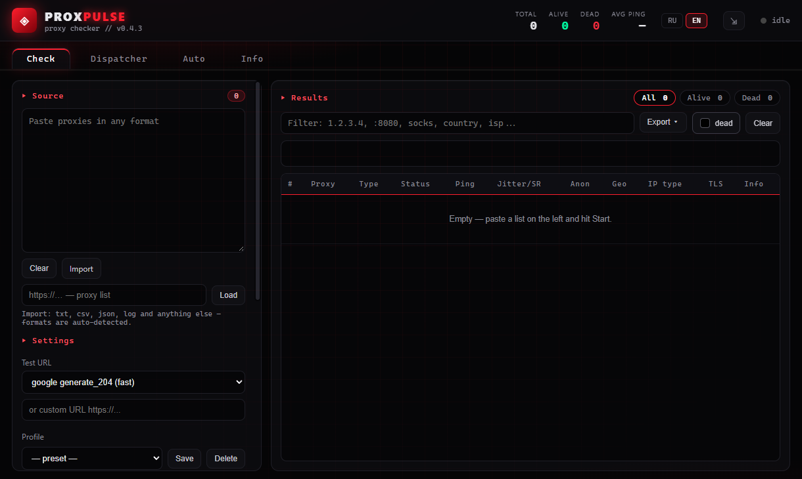

# ProxPulse

[](https://github.com/nechel12/proxpulse/releases) [](https://github.com/nechel12/proxpulse/releases) [](https://github.com/nechel12/proxpulse/actions/workflows/ci.yml)  [](src-tauri/Cargo.toml) [](https://tauri.app/) [](https://github.com/nechel12/proxpulse/commits/main) [](SECURITY.md) [](LICENSE)

*[Russian version](README.md)*

ProxPulse is a desktop proxy checker with real-time results: liveness, latency,
geolocation, anonymity, traffic integrity and TLS checks, plus a local proxy
dispatcher, scheduled re-checks and webhook delivery of working proxies.

Stack: **Tauri 2 + Rust (tokio, reqwest, rustls) + Vite + TypeScript**.
Dark theme with red accents; Russian and English UI (picked from the system
language on first launch).

## Features

- Liveness, latency, jitter and success-rate checks.
- Geolocation, IP type, anonymity, content integrity and TLS checks.
- HTTP, HTTPS (TLS to the proxy), SOCKS5/SOCKS5h and SOCKS4/SOCKS4a.
- Local HTTP/SOCKS5 dispatcher with rotation, fastest and failover modes.
- Scheduled re-checks, settings presets, TXT/JSON/CSV export and webhooks.
- File and URL import, deduplication, dark theme, RU/EN UI.
- Update checks and a system tray.

## Screenshots



Russian UI — in [README.md](README.md).

## Installation

Ready builds are available in [Releases](https://github.com/nechel12/proxpulse/releases):

- **Windows (x64):** `-setup.exe` or `.msi` installer, and a portable `.exe`;
- **Linux (x64):** `.AppImage`, `.deb`, `.rpm`;
- **macOS:** `.dmg` for Apple Silicon and Intel.

Built-in auto-update works for Windows NSIS (`-setup.exe`), macOS and the
Linux AppImage. MSI, `.deb` and `.rpm` are installed and updated manually
(installer or package manager). Portable builds are updated by replacing the
file. The file to download for each platform is described in the release notes.

> **macOS:** builds are not signed with an Apple certificate. On first launch,
> open the app from the context menu → Open, or run `xattr -cr ProxPulse.app`.
> The author does not have access to a Mac: macOS builds are verified by
> successful compilation only; they have not been run and are not guaranteed
> to work. If you encounter problems, attach the diagnostics from the Info tab.

## Build from source

Requirements: [Node.js 22.12+](https://nodejs.org/), [Rust](https://rustup.rs/)
(stable, 1.90 or newer) and WebView2 (built into Windows 10/11). Linux builds
additionally need WebKitGTK and other system packages.

<details>
<summary>Linux build dependencies (Debian/Ubuntu)</summary>

```sh
sudo apt update
sudo apt install -y libwebkit2gtk-4.1-dev build-essential curl wget file \
  libxdo-dev libssl-dev libayatana-appindicator3-dev librsvg2-dev
```

</details>

```sh
npm install           # or npm ci for a lockfile-based install
npm run tauri dev     # development mode
npm run tauri build   # release build; requires TAURI_SIGNING_PRIVATE_KEY
npm run build:unsigned # local build without updater artifacts or a key
```

The release build signs updater artifacts with the CI key
(`TAURI_SIGNING_PRIVATE_KEY`). For a local build without access to the key,
use `npm run build:unsigned`: it disables `createUpdaterArtifacts` and does
not try to sign installers. Do not publish such a build as an update — use it
for local runs and checks only.

Checks:

```sh
npm run build         # tsc + vite build
npm test              # vitest: parsing, presets, CSV, export, i18n, formatting
npm run lint          # ESLint
cargo fmt --manifest-path src-tauri/Cargo.toml -- --check
cargo test --manifest-path src-tauri/Cargo.toml --lib
cargo clippy --manifest-path src-tauri/Cargo.toml --all-targets -- -D warnings
npm run check:versions
```

CI (`.github/workflows/ci.yml`) runs these checks on pushes to `main` and on
pull requests, and also compiles the release binary without bundling
(`npm run build:unsigned -- --no-bundle`) to catch Tauri package version
mismatches and build errors.

## Checking (the “Check” tab)

Paste a list into the field on the left (one proxy per line) and click
**Start**. Results appear as checks complete. **Stop** aborts the current check.

### Supported formats

The format is detected automatically; scheme case does not matter:

- `127.0.0.1:8080`, `proxy.example.com:8080`, `[2001:db8::1]:8080`
- `user:pass@127.0.0.1:8080`
- `http://…`, `https://…`
- `socks5://…`, `socks5h://…`, `socks://…`
- `socks4://…`, `socks4a://…`
- `127.0.0.1:8080:user:pass` and the reverse order `user:pass:127.0.0.1:8080`
- `127.0.0.1:8080:socks5` (protocol as a suffix)
- CSV, tabs and spaces: `127.0.0.1,8080,user,pass`
- JSON: an object, array or log with `host`, `port`, `username`, `password`
- Numbered lists (`1) …`, `- …`) and `# …` / `// …` comments

Duplicates are removed automatically. A list can be imported from any text
file (TXT, CSV, JSON, LOG) or from a URL: the built-in client downloads up to
2 MB and parses it with the same parser.

> Put IPv6 addresses in square brackets: `[2001:db8::1]:8080`. The unbracketed
> form is ambiguous and is not supported.

> `socks4` does not support IPv6 literals. Use `socks5` or `socks4a` for IPv6;
> with `socks4a`, the IPv6 address is passed as a domain name (best effort;
> support depends on the proxy).

### Check server

The check server is selected in the settings and comes in two flavours.

**Public server** — a ready-made endpoint or a custom URL:

- `google generate_204`, `cloudflare generate_204` — fast, empty body;
- `api.ipify.org`, `httpbin.org/ip` — show the exit IP;
- `http://ip-api.com/json` — IP and geolocation in one request (free tier is HTTP-only);
- `example.com` — a regular page;
- **“Custom URL…”** — a separate list item: the input appears only when it is
  selected and never silently overrides the presets. The effective URL that
  will be requested is shown below the list.

**ProxPulse Judge** — a dedicated check backend. The built-in public instance
`https://proxycheck.lmtunnel.com` is used by default; “Custom server…” opens
an input for another instance.
Modes: **Fast** (`/generate_204`) and **Full** (`/judge` — geolocation,
anonymity and IP type in one response, plus a content-hash integrity check).
Judge mode replaces the deep checks with its own response.

> **An HTTPS judge cannot detect anonymity or integrity.** A request to an
> `https://` URL travels inside a TLS tunnel (CONNECT or SOCKS): the proxy
> cannot see it, add `Via`/`X-Forwarded-For` or alter the response, so every
> proxy would look `elite` and `ok`. In that case the “Anon” and “Integrity”
> columns stay empty (`—`); geo and IP type are still filled in. Use your own
> judge over `http://` to detect anonymity.
>
> An HTTP judge receives your real IP in the `direct_ip` parameter, which is
> how it spots proxies that forward it. An HTTPS judge does not get this
> parameter, since it cannot detect such a leak anyway.

> **ip-api: free tier vs Pro.** The free ip-api endpoint is HTTP-only: the
> proxy and the network see requests and your IP, and a response can be
> modified in transit. This is a deliberate trade-off; using the free HTTP
> endpoint is at your own risk. The Pro plan enables HTTPS and uses an API
> key (`https://pro.ip-api.com/...?key=...`, Pro page:
> <https://members.ip-api.com/>). Enable "ip-api Pro" and enter the key in
> the check settings; ip-api requests (both the main test URL and the deep
> geo lookup) will then use HTTPS.
>
> ip-api requests are made **through the checked proxy**, so the proxy sees
> both the key and the traffic. Use a dedicated key for this app; ip-api IP
> restrictions will not work when requests go through proxies. The key is
> stored locally in `localStorage` (like webhook URLs). Do not use the free
> tier for commercial use — that is an ip-api restriction.

### Check settings

| Parameter | Default | Description |
|---|---|---|
| Timeout | 5000 ms | single HTTP request limit (1000–30000) |
| Threads | 50 | parallel checks (1–500) |
| Samples | 1 | repeats per proxy for ping, jitter and success rate (1–5); every sample opens a new connection, so the ping includes connecting to the proxy |
| No-scheme type | HTTP | value used when no scheme is given; HTTP + SOCKS5 mode checks both |
| Port precheck | on, 1500 ms | fast TCP connect: unavailable proxies are dropped before the full check |

Settings are grouped into presets: “Fast” (liveness only), “Standard” (all
deep checks), “Deep” (ip-api and 3 samples) and “Judge” (built-in Judge, full
mode). A preset is applied with one click; editing any parameter manually
clears the selection. Custom presets are saved with “+ Save” and removed with
the × button. Timeout, threads, samples, no-scheme type and precheck live in
the collapsible “Parameters” block.

### Deep checks (not used in Judge mode)

- **Geolocation and IP type** — via ip-api: country, city, ISP, ORG, ASN,
  mobile/datacenter/residential.
- **Anonymity** — `elite` / `anonymous` / `transparent`: heuristics over the
  headers seen by `http://httpbin.org/headers?show_env=1` and comparison with
  the direct IP.
- **Content integrity** — the `http://example.com` body compared with a direct
  connection (`ok` / `modified`).

Anonymity and integrity are checked **over plain HTTP**: only then does the
proxy see the request and get a chance to add its own headers or alter the
response. Over `https://` a proxy merely tunnels the traffic, so these checks
would show nothing. Proxies that allow only CONNECT to port 443 fail these
checks and the column stays empty.
- **TLS integrity** — example.com certificate SHA256 compared with a direct
  connection (`ok` / `modified`).

Each deep check makes additional requests through the proxy, so all of them can
be disabled. They are not needed in Judge mode: Judge returns the data itself.

> **Public API limits.** Free ip-api has a per-minute request limit and
> httpbin.org is regularly throttled. To avoid flooding ip-api at 500-way
> concurrency, at most 8 geo lookups run at once; anonymity, integrity and
> TLS checks are also concurrency-limited. Under load the corresponding deep
> check is skipped for some proxies (run the check again). The geo cache (up to 2000 entries,
> 6-hour TTL) reduces repeated lookups but does not replace a self-hosted
> service. For
> stable results, use [ProxPulse Judge](https://github.com/nechel12/proxpulse-judge).

Deep checks are heuristics. If a baseline request fails, anonymity may stay
empty. The TLS check reports `mod` when a certificate is rejected and `n/v`
(`unverified`) when the handshake fails for another reason (for example, the
proxy blocks example.com:443).

### Export

**Export** menu: `.txt` (normalized proxies, including the scheme), `.json`
(full results), `.csv` (table with the original string and `url`), **Copy**.
The **“dead”** toggle controls whether unavailable proxies are included in the
export. Saving uses the system dialog.

Below the table, a sparkline shows the average ping of working proxies across
checks; the history is stored locally.

## Dispatcher (the “Dispatcher” tab)

Starts a local proxy on **127.0.0.1:1080** (default port) and routes traffic
through working proxies from checks. One port accepts **both HTTP and SOCKS5**
(the protocol is detected from the first byte) or only the selected protocol.
If the port is busy, the next free one is selected (+1, +2, …); the actual port
is shown in the field.

- Modes: **rotation**, **fastest**, **failover**. Fastest makes a single
  attempt through the best upstream; failover tries up to five; rotation
  picks an upstream when a connection is established. An HTTPS tunnel
  (CONNECT) stays on one upstream until it closes. Every plain HTTP request
  gets `Connection: close` and its own connection, so a request to another
  site never lands in someone else's tunnel without authorization.
- For SOCKS5 upstreams (`socks5://` and `socks5h://`) the proxy resolves the
  site name, so the local DNS resolver does not see visited domains.
  `socks4://` cannot carry names and resolves locally; use `socks4a://`.
- The pool merges new entries with old ones; “Sync” and “Clear pool” (with a
  confirmation) buttons; pool filtering and sorting by ping or country.
- **Max ping** (set on the Auto tab): proxies slower than the limit do not
  enter the pool (`0` — no limit).
- Request and error counters, current upstream proxy, last error.
- The pool is re-checked on the schedule from the Auto tab; its status is
  shown here too.
- The pool is saved to disk and restored after an application restart.

## Auto (the “Auto” tab)

One schedule re-checks the shared pool every N minutes. Scheduled checks are
light: liveness, ping and country; geo is looked up only for proxies without
a country, and anonymity, integrity and TLS are not checked (the pool does not
use those results). A proxy is removed after two failed auto-checks in a row.
If no proxy answers at all, the app checks direct access to the check server:
without it (offline, waking from sleep) the pool is left unchanged and the
check is retried in a minute. Auto-checks never stop the dispatcher, even if
the pool becomes empty.

With **“Send after each auto-check”** enabled, the pool is POSTed to the
configured webhooks (up to 10, TXT/JSON/CSV format) after every check. “Check
now” and “Send now” run these actions manually.

The scheduler and webhook delivery run in the Rust backend, so checks keep
running while the window is hidden in the tray. The on/off state and interval
are persisted; after a restart the schedule is restored from the current
settings. Settings of the two former timers (dispatcher and auto) are merged
into the single schedule on first start.

By default proxy credentials are stripped from URLs before posting. The
**“Send credentials”** option includes them, but requires HTTPS; an
`http://` webhook with credentials is rejected.

A webhook response with a non-2xx status is shown as an error.
A webhook must point to a public http(s) host: local and private addresses
are rejected, and redirects are not followed.

## Info, tray and diagnostics (the “Info” tab)

- GitHub links: ProxPulse and ProxPulse Judge.
- **Diagnostics**: app version, update check via GitHub Releases, install
  (on Windows the installer closes the app; on macOS/Linux restart manually),
  report copy (version, counters, recent errors).
- The ⇲ button in the header minimizes the window to the system tray. The tray
  menu provides show/hide, dispatcher on/off with the current port, time until
  the next auto-check, webhook state and quit. Left-clicking the icon shows or
  hides the window.

## Privacy and local data

During a check, the following leaves the machine: requests to the selected
test URL; requests to ip-api, httpbin and example.com when deep checks are
enabled; direct no-proxy requests for baselines (your IP and the example.com
reference) and for a connectivity check when no proxy answered an auto-check;
requests to the selected Judge instance; a GitHub release check;
POST requests to the configured webhooks; URL list downloads.

Proxy credentials are sent to the selected proxy using its authentication
mechanism (HTTP `Proxy-Authorization` or SOCKS authentication). They also
appear in exports (TXT/JSON/CSV/clipboard) and — **only when the option is
explicitly enabled** — in webhooks. By default webhooks receive URLs without
credentials.

Stored locally in the browser: language, ping limit, webhook URLs (may contain
tokens), the ip-api Pro key (if set), geo cache (up to 2000 entries, 6-hour TTL,
credential-free keys), recent errors, ping history, current check settings,
auto-check state and settings presets. Clearing `localStorage` removes this
data.

The dispatcher pool is stored in `pool.json` in the app data directory
(Windows: `%APPDATA%\com.nechel12.proxpulse`, Linux:
`~/.local/share/com.nechel12.proxpulse`, macOS:
`~/Library/Application Support/com.nechel12.proxpulse`). The file contains the
proxies **including usernames and passwords**; on Linux and macOS it is
readable by the owner only. The pool “Clear” button clears the file as well.

## Security

Do not publish working proxies, passwords or other secrets in issues. To
report a vulnerability, use GitHub's private vulnerability reporting:
[report a vulnerability](https://github.com/nechel12/proxpulse/security/advisories/new).
See [SECURITY.md](SECURITY.md) for details.

## Project structure

```text
index.html                          # screen markup
src/main.ts                         # UI entry point and event wiring
src/check-client.ts                 # check runs over a Tauri Channel
src/source-panel.ts                 # list input and import
src/settings-panel.ts               # check settings and ip-api Pro
src/profiles.ts, profiles-panel.ts  # settings presets
src/pool.ts                         # alive proxy pool
src/results.ts, format.ts           # results table and formatting
src/csv.ts, export.ts               # escaping and TXT/JSON/CSV export
src/export-panel.ts                 # save dialog and copy
src/auto-settings.ts                # auto-check settings
src/auto-status.ts, auto-events.ts  # auto-check status and events
src/webhooks.ts                     # webhook panel
src/dispatch-monitor.ts             # local dispatcher monitor
src/updater.ts, info-panel.ts       # updates and app info
src/parse.ts                        # proxy parsing (pure functions)
src/parse-runner.ts, parseWorker.ts # worker parsing with fallback
src/geocache.ts, geo-store.ts       # geo cache
src/i18n.ts                         # RU/EN dictionaries
src/*.test.ts                       # pure-module tests (vitest)
src/styles.css                      # dark theme
src-tauri/src/lib.rs                # backend entry point
src-tauri/src/commands/*.rs         # Tauri commands (check, dispatch, auto, tray, ...)
src-tauri/src/http.rs               # HTTP clients, body limits, geo
src-tauri/src/proxy.rs              # proxy parsing/normalization
src-tauri/src/transport.rs          # SOCKS/HTTP CONNECT and TLS to proxies
src-tauri/src/tls.rs                # TLS config and certificate fingerprints
src-tauri/src/netguard.rs           # SSRF guard for user-supplied URLs
src-tauri/src/tests/*.rs            # backend tests
src-tauri/src/main.rs               # app entry point
src-tauri/tauri.conf.json           # Tauri configuration
src-tauri/Cargo.toml                # Rust dependencies
eslint.config.js                    # ESLint
.github/workflows/ci.yml            # tests, clippy and version check
.github/workflows/release.yml       # release builds and auto-update files
scripts/check-versions.mjs          # version synchronization
```

## Related projects

- [ProxPulse Judge](https://github.com/nechel12/proxpulse-judge) — a
  self-hosted check backend (Rust/axum, Docker). The public instance is used
  in Judge mode by default.

## Contributing

Bug reports and pull requests are welcome. In a bug report, include the app
version, operating system and diagnostics from the Info tab — the issue form
asks for them. Before opening a PR, run all checks from “Build from source”;
see [CONTRIBUTING.md](CONTRIBUTING.md) for details,
[CHANGELOG.md](CHANGELOG.md) for the history of changes and
[CODE_OF_CONDUCT.md](CODE_OF_CONDUCT.md) for conduct rules.

Issue tracker: [Issues](https://github.com/nechel12/proxpulse/issues).

## License

Apache-2.0. See [LICENSE](LICENSE).
