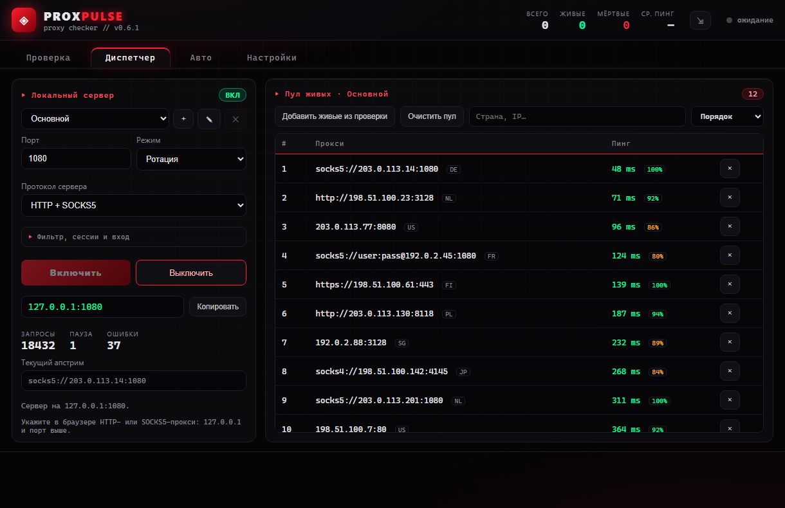

# Диспетчер

[English](dispatcher.md) | **Русский**



Вкладка **Диспетчер** поднимает локальный прокси на `127.0.0.1:1080` (или
следующем свободном порту) и направляет трафик через пул живых прокси. Один
порт принимает HTTP и SOCKS5 (определяется по первому байту) или только
выбранный протокол.

| Режим | Поведение |
|---|---|
| Ротация | для каждого соединения начинает со следующего апстрима; до пяти попыток |
| Самый быстрый | всегда апстрим с наименьшей задержкой; одна попытка |
| Замена при падении | сначала самый быстрый апстрим, затем следующие; до пяти попыток |

- HTTPS-туннель (CONNECT) идёт через один апстрим до закрытия; каждый
  обычный HTTP-запрос получает своё соединение (`Connection: close`).
- SOCKS5-апстримы сами резолвят имена сайтов, поэтому локальный DNS не видит
  посещаемые домены (`socks4` так не умеет и резолвит локально).
- Пул пополняется после каждой проверки (старые записи сохраняются),
  фильтруется, сортируется, синхронизируется, очищается и сохраняется на диск
  между запусками.
- Счётчики запросов и ошибок, текущий апстрим и последняя ошибка обновляются
  в реальном времени.

Блок **Фильтр, сессии и вход** применяется сразу и сохраняется до
следующего запуска:

- **Страны апстримов** — только прокси из этих стран (коды или названия, как
  в пуле); пусто — все.
- **Липкая сессия** — один апстрим на сайт в течение N минут, чтобы входы и
  корзины не прыгали между IP выхода.
- Апстрим, к которому не удалось подключиться, пропускается минуту (счётчик
  **Пауза**), если есть другие.
- **Логин** — локальные клиенты должны авторизоваться: HTTP
  `Proxy-Authorization: Basic` (браузер спросит) или логин и пароль SOCKS5.

## Именованные пулы

Меню вверху вкладок **Диспетчер** и **Авто** переключает до десяти пулов,
например «скрапинг» и «работа»; **+**, **✎** и **✕** создают, переименовывают
и удаляют их. У каждого пула свои прокси, диспетчер (порт, режим, фильтр,
сессии и вход), расписание, максимальный пинг, подписки и вебхуки.

- Живые прокси из ручной проверки попадают в показанный пул.
- Расписание каждого пула работает, какой бы пул ни был показан. Проверка
  идёт одна за раз: пулы с одновременным сроком ждут очереди.
- Диспетчеру каждого пула нужен свой порт. Диспетчер никогда не использует
  диспетчер другого пула как апстрим.
- **Запускать диспетчер** при старте запускает диспетчеры всех пулов,
  которые запускались раньше. Трей показывает основной пул и управляет им.
- Удаление пула выключает его диспетчер и удаляет расписание и прокси.

## API пула

**API пула** на вкладке «Диспетчер» отдаёт живые прокси скриптам по HTTP на
`127.0.0.1:1090` (порт можно сменить). Включённый API запускается вместе с
приложением.

| Запрос | Ответ |
|---|---|
| `GET /random` | случайный прокси (с `format=json` — один объект, а не массив) |
| `GET /fastest` | прокси с наименьшим пингом |
| `GET /list` | все подходящие прокси, по одному в строке |
| `GET /pools` | пулы: id, название и размер через табуляцию |
| `GET /` | краткая справка |

| Параметр | Смысл |
|---|---|
| `pool` | id или название пула (регистр не важен); по умолчанию основной |
| `country` | коды или названия стран, как в пуле, через запятую |
| `proto` | `http`, `https`, `socks4`, `socks5` или `socks` (оба SOCKS), через запятую |
| `limit` | 1–20000 прокси из `/list` (по умолчанию все); `/random` и `/fastest` его не учитывают |
| `format` | `txt` (по умолчанию) или `json`: объекты с `url`, `scheme`, `host`, `port`, `country`, `latency` |

```sh
curl "http://127.0.0.1:1090/random?country=DE&proto=socks5"
curl -u user:pass "http://127.0.0.1:1090/list?pool=work&format=json&limit=20"
```

- Пул с логином диспетчера отвечает только с тем же логином (HTTP Basic,
  `curl -u`), и `/pools` показывает его только тогда. Его прокси отдаются как
  URL **вместе с логинами и паролями**.
- Пул без логина может прочитать любой локальный процесс, поэтому его прокси
  отдаются без логинов и паролей. Чтобы их получать, задайте логин
  диспетчера.
- Апстримы на паузе после сбоя не выдаются, если есть другие подходящие.
- Ошибки: `400` — неверный параметр, `404` — нет подходящих прокси,
  неизвестный пул или путь, `405` — метод не `GET`.
- Запросы, у которых `Host` не `127.0.0.1` и не `localhost`, отклоняются,
  чтобы веб-страница не прочитала пул через DNS rebinding. Запрос без `Host`
  (скрипты на HTTP/1.0; браузеры его всегда отправляют) обслуживается.
